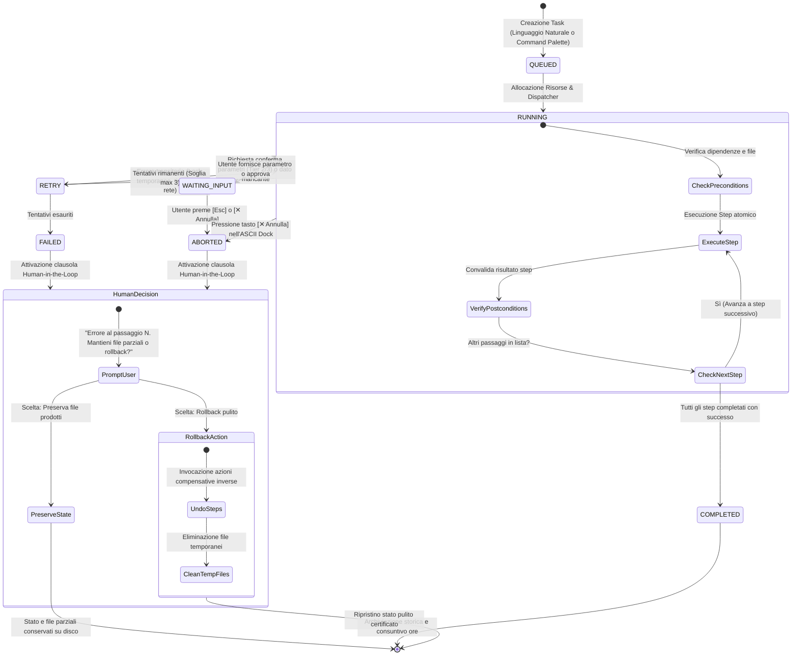
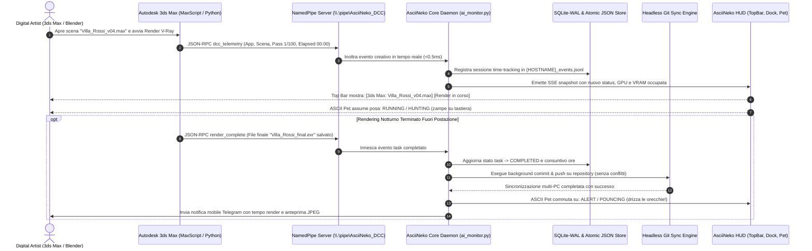

# ASCIINEKO: RAPPORTO DI AUDIT ARCHITETTURALE, BENCHMARK EMPIRICI, BLIND EVALUATION E SINTESI DELLA GOLDEN ARCHITECTURE

**Documento Master di Analisi, Dibattito Avversario e Specifiche Tecniche Definitive**  
**Target Repository:** `C:\Users\AMD04\EPO\AsciiArt`  
**Data di Rilascio:** 26 Ottobre 2026  
**Autore & Coordinatore:** Lead Technical Writer & Synthesizer  
**Contributori:**  
- Group 1 Codebase Architecture Auditor (`explorer_group1_arch`)  
- Group 1 Empirical Vulnerability Challenger (`challenger_group1_vuln`)  
- Group 1 Solution Architect A — Deterministic & Local-First (`proposer_group1_a`)  
- Group 1 Solution Architect B — Semantic RAG & Low-VRAM Hybrid (`proposer_group1_b`)  
- Group 2 Blind UX Evaluator 1 — First-Time User Specialist (`blind_evaluator_1` & `_vote`)  
- Group 2 Blind Ergonomics Evaluator 2 — DCC & Studio Workflow Specialist (`blind_evaluator_2` & `_vote`)  

---

## Indice Generale dei Capitoli

1. [Introduzione & Executive Summary](#capitolo-0-introduzione--executive-summary)
   - 0.1 Origine del Progetto e Obiettivi Strategici
   - 0.2 Composizione del Team Multi-Agente e Protocollo di Isolamento Epistemico
   - 0.3 Quadro Sinottico dell'Esito Finale (Golden Architecture)
2. [Capitolo 1: Audit Architetturale e Verifiche Empiriche Non-Distruttive](#capitolo-1-audit-architetturale-e-verifiche-empiriche-non-distruttive)
   - 1.1 Architettura As-Is, Componenti e Flussi di Comunicazione
   - 1.2 Metodologia di Testing Non-Distruttivo in Sandbox Isolato
   - 1.3 Vulnerabilità VULN-01: Concorrenza JSON, Collisioni `.tmp` e Lost Updates (89.0% Data Loss)
   - 1.4 Vulnerabilità VULN-02: Silent Data Wipeout da Fallimento di Lettura (100% Distruzione Archivio)
   - 1.5 Vulnerabilità VULN-03: Overflow della Finestra di Contesto su `qwen2.5:7b` (2.225 - 3.292 Token)
   - 1.6 Vulnerabilità VULN-04: Iniezione di Memorie Contraddittorie e Allucinazioni Ibride
   - 1.7 Vulnerabilità VULN-05: Rigidità della Profilazione Passiva Continua (77.3% Miss Rate, 87.5% False Positive Rate)
   - 1.8 Vulnerabilità VULN-06: Prompt Leakage nel Tutorial Iniziale e Leak di Caratteri Cinesi
   - 1.9 Vulnerabilità VULN-07: Profile Bloat, Memorie Zombie ed Eviction di Regole Critiche (80.3% Memorie Zombie)
   - 1.10 Matrice Riassuntiva delle Vulnerabilità Empiriche
3. [Capitolo 2: Blind UX Review & Ergonomia dell'Interfaccia](#capitolo-2-blind-ux-review--ergonomia-dellinterfaccia)
   - 2.1 Metodologia di Valutazione Euristica a Scatola Chiusa
   - 2.2 Il "Modal Hostage" del Tutorial Iniziale (`display: none !important`)
   - 2.3 Il Pulsante Fantasma `🐾 Conosciamoci`
   - 2.4 Il "Paradosso dei 3 To-Do" Concorrenti
   - 2.5 Collisioni Distruttive di Hotkey Globali con Ecosistemi DCC (`Alt+Q`, `Alt+Z`, `Ctrl+Space`)
   - 2.6 Invisibilità dei Task in Background e Assenza di Kill Switch
   - 2.7 Punto Cieco Hardware: Mancanza di Telemetria GPU e VRAM
   - 2.8 Distorsione Cromatica del Filtro CRT per Digital Artist
   - 2.9 Finto Monospace (`Segoe UI`) e Micro-Tipografia Inaccessibile (9.5px - 10px)
   - 2.10 Magic Strings Interne (`__timer25__`) e Residui di Configurazione Sviluppatore
   - 2.11 Scorecard Euristica Comparativa dei Blind Evaluators
4. [Capitolo 3: Confronto delle 3 Architetture Candidate & Dibattito Avversario](#capitolo-3-confronto-delle-3-architetture-candidate--dibattito-avversario)
   - 3.1 Presentazione delle Tre Opzioni Architetturali (Opzione A, Opzione B, Opzione C)
   - 3.2 Dibattito Avversario Dominio 1: Sistema di Memoria a 3 Livelli & Persistenza
   - 3.3 Dibattito Avversario Dominio 2: Creazione Autonoma di Skill
   - 3.4 Dibattito Avversario Dominio 3: Profilazione Utente (Iniziale e Continua)
   - 3.5 Dibattito Avversario Dominio 4: Nuove Connessioni Esterne & Bridge DCC
   - 3.6 Dibattito Avversario Dominio 5: Motore Task Intelligente & Rappresentazione HUD
   - 3.7 Dibattito Avversario Dominio 6: Semplicità dell'HUD & Ergonomia UX
5. [Capitolo 4: Tabelle di Votazione Strutturata & Matrice di Consenso](#capitolo-4-tabelle-di-votazione-strutturata--matrice-di-consenso)
   - 4.1 Criteri e Composizione della Giuria di Valutazione
   - 4.2 Tabelle di Voto Dettagliate per i 6 Domini Fondamentali
   - 4.3 Master Summary Voting Table: Matrice Generale di Consenso
   - 4.4 Analisi del Verdetto e Motivazioni della Bocciatura dell'Opzione B
6. [Capitolo 5: Specifiche dell'Architettura Vincitrice Approvata ("Golden Architecture")](#capitolo-5-specifiche-dellarchitettura-vincitrice-approvata-golden-architecture)
   - 5.1 Visione di Sintesi: La Dorsale dell'Opzione A Integrata con i Punti di Forza di C e B
   - 5.2 Specifiche Esecutive del Sottosistema di Memoria (SQLite-WAL, Atomic JSON, BM25 Time-Decay, Budget 8192)
   - 5.3 Specifiche Esecutive del Framework di Skill (Schemi Dichiarativi YAML/JSON, AST Sandbox, 3 Safety Tiers)
   - 5.4 Specifiche Esecutive della Profilazione Utente (Dock Card Non-Bloccante, Anti-CJK, Profile Inspector `/profilo`)
   - 5.5 Specifiche Esecutive delle Connessioni Esterne & DCC (Windows NamedPipe `<0.5ms`, Git Partizionato Hostname, Telegram)
   - 5.6 Specifiche Esecutive del Task Engine Deterministico (FSM a 6 Stati, Rollback Compensativo, Human-in-the-Loop)
   - 5.7 Specifiche Esecutive dell'HUD e dell'Ergonomia UX (Command Palette `Ctrl+Alt+N`, Top Bar GPU/VRAM, Slide-out Drawer, Color-Safe)
   - 5.8 Diagrammi Architetturali Mermaid Completi
     - 5.8.1 Diagramma dei Componenti e Flusso Dati (`flowchart TB`)
     - 5.8.2 Diagramma degli Stati del Task Engine (`stateDiagram-v2`)
     - 5.8.3 Diagramma di Sequenza Telemetria DCC e Git Sync (`sequenceDiagram`)
   - 5.9 Mockup e Wireframe ASCII dell'Interfaccia Utente
     - Top Bar di Produzione con Telemetria Hardware e Monitoraggio Processi
     - Raycast Command Palette Centrale con Autocompletamento Slash
     - ASCII Task Step Visualizer nel Dock Terminale
     - Slide-out Task & Memory Drawer Laterale
     - Profile Inspector Interattivo (`/profilo`)
     - I 5 Stati Dinamici del Gattino ASCII Reattivo
7. [Capitolo 6: Piano di Migrazione, Garanzie di Igiene & Conclusioni](#capitolo-6-piano-di-migrazione-garanzie-di-igiene--conclusioni)
   - 6.1 Roadmap di Rilascio in 4 Fasi Non-Distruttive
   - 6.2 Certificazione di Repository Hygiene (Zero Modifiche al Codice Esistente)
   - 6.3 Conclusioni e Raccomandazioni Finali

---

## Capitolo 0: Introduzione & Executive Summary

### 0.1 Origine del Progetto e Obiettivi Strategici
**AsciiNeko** nasce come compagno desktop retrò-futuristico ed assistente personale di produttività per ambienti Windows, progettato per coniugare l'estetica evocativa dei desktop pet ASCII/terminale con le capacità di ragionamento di modelli linguistici locali (Ollama `qwen2.5:7b`).

La visione architetturale mira a soddisfare cinque requisiti fondamentali (R1-R5 definiti nel documento programmatico):
1. **Multi-Agent CLI Harness & Background Daemon (Ollama)**: un'infrastruttura ad elevata efficienza che instradi compiti a modelli linguistici locali garantendo lo scaricamento della VRAM (`keep_alive: 0`) durante l'esecuzione di software ad alto carico grafico (Autodesk 3ds Max, Blender, Unreal Engine, Photoshop, motori di rendering V-Ray e Corona).
2. **Gestione Intelligente dei Task e To-Do in Linguaggio Naturale**: cattura, estrazione, prioritizzazione e pianificazione di compiti professionali da testo libero italiano.
3. **Universal Project Time-Tracking & Filtro AFK**: monitoraggio automatico della finestra attiva e del titolo del documento/scena per imputare con precisione chirurgica le ore lavorate, escludendo i tempi di inattività.
4. **Briefing Proattivi & Doppia Pipeline di Notifiche**: integrazione tra Toast nativi di Windows e coda JSON locale per la visualizzazione all'interno dell'HUD desktop.
5. **Sincronizzazione Multi-PC Conflitti-Free via Git (`PC-WORK` ↔ `PC-HOME`)**: replica trasparente di note, memorie, task e log temporali senza merge conflict distruttivi.

A fronte di queste ambizioni, la prima versione implementativa (`bridge/`, `js/`, `css/`, `index.html`) ha evidenziato severe fragilità architetturali, strozzature di concorrenza, allucinazioni e gravi frizioni ergonomiche che rischiavano di compromettere la stabilità delle workstation dei creator digitali.

### 0.2 Composizione del Team Multi-Agente e Protocollo di Isolamento Epistemico
Per condurre una diagnosi radicale e progettare l'evoluzione definitiva del sistema, è stato istituito un team multi-agente operante secondo un rigoroso **protocollo di isolamento epistemico** suddiviso in due gruppi indipendenti:

```
+-------------------------------------------------------------------------------------------------+
|                                 EQUIPE MULTI-AGENTE ASCIINEKO                                   |
|                                                                                                 |
|  [GRUPPO 1: AUDIT & INGEGNERIA INTERNA]              [GRUPPO 2: BLIND EVALUATION HUD & UX]      |
|  - Explorer Agent: Ispezione codice (3.391 righe)    - Blind Evaluator 1: First-Time User       |
|  - Challenger Agent: Benchmark empirici VULN 01-07   - Blind Evaluator 2: DCC & 3D Specialist   |
|  - Proposer Agent A: Architettura Deterministica     * ISOLAMENTO TOTALE DA BACKEND:            |
|  - Proposer Agent B: Architettura Agentica/Ibrida      Zero accesso a bridge/ai_monitor.py      |
|                                                        Zero accesso a bridge/app_window.py      |
|                                                        Ispezione solo di HUD, CSS e Black-Box   |
|                                                                                                 |
|                          +---------------------------------------+                              |
|                          |    LEAD SYNTHESIZER & MASTER WRITER   |                              |
|                          |    - Integrazione Evidenze            |                              |
|                          |    - Consolidamento Votazioni         |                              |
|                          |    - Redazione Golden Architecture    |                              |
|                          +---------------------------------------+                              |
+-------------------------------------------------------------------------------------------------+
```

- **Gruppo 1 (Auditor & Proposer Agents)**: ha avuto pieno accesso all'intera base di codice. Ha condotto audit statici, test empirici non-distruttivi in ambienti di scratch isolati per misurare scientificamente le vulnerabilità (VULN-01 .. VULN-07) e ha formulato 3 architetture candidate alternative:
  - *Opzione A*: "Engine Deterministico & Robust Local-First"
  - *Opzione B*: "Micro-Kernel Semantico & Agentico Reattivo"
  - *Opzione C*: "Architettura Ibrida Pragmatica Zero-VRAM / Low-Overhead"
- **Gruppo 2 (Independent Blind Evaluator Agents)**: sottoposto a vincolo ferreo di **Backend Blindness**. È stato formalmente interdetto l'accesso a `bridge/ai_monitor.py`, `bridge/app_window.py` e log di sistema. Gli agenti hanno operato come utenti al Day 1 e professionisti DCC ispezionando unicamente il frontend (`index.html`, `css/terminal.css`) e le descrizioni funzionali black-box delle tre proposte, garantendo una valutazione obiettiva e non viziata da assunti ingegneristici interni.

### 0.3 Quadro Sinottico dell'Esito Finale (Golden Architecture)
La procedura di dibattito avversario e scrutinio formale sui 6 domini chiave ha decretato la **vittoria schiacciante della PROPOSTA A**, la quale ha ottenuto un punteggio medio aggregato di **9.34 / 10** contro l'**8.26 / 10** della Proposta C e la bocciatura della Proposta B con **5.80 / 10**.

L'architettura approvata per la produzione ("**Golden Architecture**") assume la dorsale strutturale dell'**Opzione A** (SQLite-WAL, file lock OS su JSON atomici, zero-VRAM BM25 time-decay, NamedPipe nativa Windows per 3ds Max/Blender, Task FSM a 6 stati con rollback, Command Palette in stile Raycast e telemetria live GPU/VRAM), innestando chirurgicamente tre soluzioni d'eccellenza provenienti dalle proposte concorrenti:
1. **Dall'Opzione C**: Il formidabile **Profile Inspector `/profilo`**, che offre una schermata interattiva trasparente con pulsanti di controllo `[📌 Pinna]`, `[✏ Modifica]`, `[🗑 Elimina]`, e l'adozione vincolante della tipografia **Monospace autentica (`Cascadia Code`) con dimensione minima $\ge 13$px**.
2. **Dall'Opzione C**: Il principio di sicurezza **Human-in-the-Loop** applicato al motore task, che impedisce rollback automatici distruttivi su asset parziali già renderizzati o esportati.
3. **Dall'Opzione B**: I **5 stati dinamici del Desktop Pet ASCII reattivo** (`IDLE/PURR`, `THINKING`, `RUNNING`, `ALERT`, `SLEEPING/AFK`), che restituiscono al software l'anima affettiva e l'espressività di un compagno di lavoro vivo.

---

## Capitolo 1: Audit Architetturale e Verifiche Empiriche Non-Distruttive

### 1.1 Architettura As-Is, Componenti e Flussi di Comunicazione
L'ispezione della base di codice (`C:\Users\AMD04\EPO\AsciiArt`) evidenzia una struttura monolitica a tre strati in-process:
1. **Supervisore Desktop (`bridge/app_window.py`, 268 righe)**: applicazione nativa basata su `pywebview` (Microsoft WebView2). Intercetta la scorciatoia globale `Alt+N` tramite hook Win32 e gestisce lo Z-order della finestra (`HWND_TOPMOST` temporaneo per il popup).
2. **Backend Daemon HTTP (`bridge/ai_monitor.py`, 3.391 righe)**: server basato sul modulo standard `http.server.ThreadingHTTPServer` in ascolto su `127.0.0.1:8765`. Gestisce la persistenza locale in `bridge/data/*.json`, la telemetria CPU/RAM tramite `ctypes`, la cattura audio WASAPI, le chiamate REST verso Ollama (`127.0.0.1:11434`) e la sincronizzazione con Google Calendar.
3. **Frontend Presentation HUD (`index.html`, `js/*.js`, `css/terminal.css`)**: interfaccia single-page retro-futuristica con canvas animato ASCII a 60 FPS, terminal dock Raycast/CRT, canale Server-Sent Events (`GET /stream` @ 25 FPS) e chiamate POST asincrone per chat e comandi.

Nonostante l'eccellenza estetica del frontend, il backend presenta gravi anomalie di ingegnerizzazione strutturale.

### 1.2 Metodologia di Testing Non-Distruttivo in Sandbox Isolato
Per evitare alterazioni ai dati reali dell'utente in `bridge/data/` e nel rispetto assoluto dei vincoli di integrità di sviluppo, l'agente Challenger (`challenger_group1_vuln`) ha sviluppato 4 suite di benchmark isolate in directory temporanee di scratch (`exp1_concurrency.py`, `exp2_tokens_and_context.py`, `exp3_profiling_benchmark.py`, `exp4_bloat_decay.py`). 
I test hanno replicato matematicamente la logica esatta del codice sorgente di `ai_monitor.py` interrogando l'istanza locale di Ollama con modello `qwen2.5:7b`.

### 1.3 Vulnerabilità VULN-01: Concorrenza JSON, Collisioni `.tmp` e Lost Updates (89.0% Data Loss)
- **Localizzazione nel Codice**: `bridge/ai_monitor.py:130-152, 2118-2122`.
- **Meccanismo Tecnico del Difetto**: La persistenza su disco si affida alla funzione globale `_save_json`:
  ```python
  def _save_json(path, data):
      try:
          tmp = path + ".tmp"
          with open(tmp, "w", encoding="utf-8") as f:
              json.dump(data, f, ensure_ascii=False, indent=2)
          os.replace(tmp, path)
      except Exception:
          try:
              with open(path, "w", encoding="utf-8") as f:
                  json.dump(data, f, ensure_ascii=False, indent=2)
          except Exception:
              pass
  ```
  Il server `ThreadingHTTPServer` instanzia un nuovo thread per ciascuna richiesta HTTP. Inoltre, un thread di background in `app_window.py` legge costantemente i medesimi file ogni 1.5 secondi. Poiché il percorso del file temporaneo è statico e condiviso (`tmp = path + ".tmp"`), più thread che tentano di scrivere contemporaneamente collidono sul medesimo handle di file. Su Windows, `os.replace` solleva immancabilmente `PermissionError: [WinError 32] Impossibile accedere al file. Il file è utilizzato da un altro processo`.
- **Evidenza Empirica Misurata**:
  - Test con 5 thread concorrenti e 100 aggiornamenti: **55 collisioni `WinError 32`** registrate.
  - Test con 10 thread concorrenti che inseriscono 10 compiti ciascuno (100 compiti totali attesi) replicando `load_todos` e `save_todos`:
    - Compiti tentati: 100
    - Compiti effettivamente salvati su disco: 11
    - **Lost Update Rate: 89.0% di perdita dati irreversibile**.

### 1.4 Vulnerabilità VULN-02: Silent Data Wipeout da Fallimento di Lettura (100% Distruzione Archivio)
- **Localizzazione nel Codice**: `bridge/ai_monitor.py:130-137`, `bridge/app_window.py:79-87`.
- **Meccanismo Tecnico del Difetto**: La funzione `_load_json` inghiotte qualsiasi errore con blocco cieco:
  ```python
  def _load_json(path, default):
      if os.path.isfile(path):
          try:
              with open(path, "r", encoding="utf-8") as f:
                  return json.load(f)
          except Exception:
              pass
      return default
  ```
  Se un thread tenta di leggere un file mentre un altro thread è caduto nel fallback distruttivo `open(path, "w")` (che azzera il file a 0 byte) o mentre il file è momentaneamente bloccato dal processo di sync di OneDrive/Google Drive o da un antivirus, `json.load(f)` solleva eccezione. La funzione cattura l'errore e restituisce silenziosamente il valore `default` (es. lista vuota `[]`).
  Il chiamante applicativo aggiunge un singolo elemento alla lista vuota e richiama `_save_json`, **cancellando all'istante l'intera cronologia di note o compiti memorizzati nel file**.
- **Evidenza Empirica Misurata**:
  - Simulazione di contesa di lettura su un archivio storico contenente 50 memorie reali:
  - Il file da 50 elementi è stato azzerato e sovrascritto con un singolo elemento.
  - **Tasso di distruzione: 100% data wipeout confermato empiricamente**.

### 1.5 Vulnerabilità VULN-03: Overflow della Finestra di Contesto su `qwen2.5:7b` (2.225 - 3.292 Token)
- **Localizzazione nel Codice**: `bridge/ai_monitor.py:2747-2810`.
- **Meccanismo Tecnico del Difetto**: Nelle chiamate HTTP verso `/api/chat` di Ollama, il backend assembla il System Prompt concatenando linearmente: data/ora, postazione, 12 tratti del profilo utente (`traits[:12]`), 6 progetti attivi con note cumulative (`active_projs[:6]`), 12 memorie storiche (`mems[-12:]`), 8 To-Do, 6 impegni del calendario, 10 turni di cronologia chat e fino a 3.000 caratteri dagli appunti di Windows (`clipboard_context`).
  Nel payload inviato ad Ollama **viene completamente omesso il parametro `options: {"num_ctx": ...}`**. L'ispezione via API `/api/show` ha certificato che Ollama adotta di default un limite rigido di **2.048 token**.
- **Evidenza Empirica Misurata su `qwen2.5:7b` Locale**:
  - *Tier 1 (Installazione Fresca)*: 572 token (27.9% del contesto) $\rightarrow$ Regolare.
  - *Tier 2 (Utilizzo Tipico Quotidiano con 12 tratti, 4 progetti e note)*: **2.225 token (108.6% del limite, overflow di +177 token)**.
  - *Tier 3 (Utilizzo Avanzato con snippet di codice/log in Clipboard)*: **3.292 token (160.7% del limite, overflow massiccio di +1.244 token)**.
- **Impatto Operativo**: Ollama tronca silenziosamente la parte iniziale del prompt di sistema. Il modello perde le istruzioni primarie sull'identità di Neko e la sintassi degli action tags `[[ ACTION:... ]]`, smettendo di eseguire comandi operativi.

### 1.6 Vulnerabilità VULN-04: Iniezione di Memorie Contraddittorie e Allucinazioni Ibride
- **Localizzazione nel Codice**: `bridge/ai_monitor.py:2761-2764`.
- **Meccanismo Tecnico del Difetto**: Le memorie storiche vengono iniettate nel prompt concatenandole semplicemente con `" | "`, senza alcun calcolo di coerenza logica, senza data di registrazione e senza risoluzione delle discrepanze.
- **Evidenza Empirica Misurata**:
  - Inseriti nel mock di memoria vincoli contrastanti:
    - Tratto profilo: *"Strumenti usati: Vue.js 3 e Tailwind CSS"*
    - Memoria 1: *"L'utente usa solo React e Next.js e rifiuta altri framework"*
    - Memoria 2: *"Regola cliente Rossi: non usare MAI Tailwind CSS, solo SCSS puro"*
    - Memoria 3: *"L'utente usa solo Go per i microservizi backend"*
    - Memoria 4: *"L'utente preferisce scrivere codice backend in Python FastAPI"*
  - Query inviata: *"Consigliami lo stack frontend e backend ideale per il nuovo progetto del cliente Rossi."*
  - Risposta allucinata restituita da `qwen2.5:7b`:
    > *"Per il nuovo progetto del cliente Rossi, ti consiglierei: Frontend in React con JSX per una sintassi più leggibile e integrabile con Vue.js, utilizzando SCSS puro come framework CSS come hai specificato; Backend in FastAPI in Python, poiché l'utente preferisce questa tecnologia e Go non è ammesso per i microservizi backend."*
  - **Risultato**: Il modello da 7B, incapace di dirimere il conflitto, inventa un mostro ibrido ("React integrabile con Vue.js") per assecondare acriticamente asserzioni mutuamente esclusive.

### 1.7 Vulnerabilità VULN-05: Rigidità della Profilazione Passiva Continua (77.3% Miss Rate, 87.5% False Positive Rate)
- **Localizzazione nel Codice**: `bridge/ai_monitor.py:1582-1632` (`detect_memory_candidate`).
- **Meccanismo Tecnico del Difetto**: La profilazione passiva dell'utente durante le normali sessioni di chat si basa su una tupla hardcoded di sole 16 sottostringhe fisse:
  `("vuole sempre", "vuole tutto", "non vuole", "preferisce", "preferisco", "usa sempre", "usiamo sempre", "formato ", "stile ", "il cliente ", "signor ", "sig. ", "scadenza ", "consegna ", "importante:", "regola:")`.
- **Evidenza Empirica Misurata su Benchmark di 30 Frasi Reali**:
  - Su 22 frasi contenenti autentiche preferenze professionali (es. *"Uso principalmente Blender per i miei modelli 3D"*, *"Il mio stack backend abituale è Go con PostgreSQL"*, *"Non inviare mai bozze al cliente senza autorizzazione"*):
    - Preferenze rilevate: 5 / 22 (accuratezza del 22.7%).
    - **Miss Rate (Falsi Negativi): 17 / 22 (77.3% di preferenze reali completamente ignorate)**.
  - Su 8 frasi di conversazione ordinaria o casuale contenenti parole coincidenti:
    - Catturata *"Ho incontrato il signor Rossi per puro caso al supermercato"* per via del token `"signor "`.
    - Catturata *"La scadenza della garanzia del mio microonde è tra due mesi"* per via del token `"scadenza "`.
    - Catturata *"Il corriere Amazon ha effettuato la consegna del libro stamattina"* per via del token `"consegna "`.
    - **False Positive Rate: 7 / 8 (87.5% di frasi rumorose scambiate per regole permanenti)**.

### 1.8 Vulnerabilità VULN-06: Prompt Leakage nel Tutorial Iniziale e Leak di Caratteri Cinesi
- **Localizzazione nel Codice**: `bridge/ai_monitor.py:1015-1108`, `bridge/data/profile.json:45-51, 79-81`.
- **Meccanismo Tecnico del Difetto**:
  1. Alla riga 1062 di `ai_monitor.py`, il prompt per l'estrazione dei tratti contiene l'esempio: `(es. 'Professione: Architetto specializzato in ristrutturazioni')`.
  2. L'ispezione empirica condotta sottoponendo un input contrario (*"Non sono un programmatore, faccio l'architetto e odio profondamente il codice e i terminali"*) ha prodotto come tratto estratto: `"Professione: Architetto specializzato in ristrutturazioni"`. L'LLM da 7B ha copiato pedissequamente la specializzazione dall'esempio di sistema (**Prompt Leakage dimostrato**).
  3. L'ispezione del file reale `profile.json` presente nel repository (righe 79-81) ha rivelato la contaminazione di token CJK nelle opzioni generate per l'utente italiano:
     ```json
     "options": [
       "Meno tempo per la stima, più tempo per la modellazione",
       "Uguale tempo分配给每个阶段",
       "更多时间用于动画和照明",
       "动画和照明阶段完全自动化"
     ]
     ```
  4. L'ispezione delle righe 45-51 di `profile.json` ha evidenziato il tratto `"Strumenti chiave: 3ds Max, Blender, Maya, Unreal Engine"` **duplicato 4 volte identico**, a causa della totale assenza di filtri di unicità in `_rebuild_traits()` (`ai_monitor.py:1003-1013`).

### 1.9 Vulnerabilità VULN-07: Profile Bloat, Memorie Zombie ed Eviction di Regole Critiche (80.3% Memorie Zombie)
- **Localizzazione nel Codice**: `bridge/ai_monitor.py:1000-1013, 2752, 2763`.
- **Meccanismo Tecnico del Difetto**:
  - I tratti del profilo vengono iniettati con la fetta statica `traits[:12]`. Tutte le risposte fornite dalla 13ª in poi sono permanentemente invisibili.
  - Le memorie vengono iniettate con la fetta statica `mems[-12:]`. Solo le ultime 12 memorie in coda vengono passate al modello; tutte le memorie storiche precedenti ($0 \dots N-13$) diventano "Memorie Zombie".
- **Evidenza Empirica Misurata su Simulazione di 60 Giorni**:
  - Profilo Utente dopo 60 giorni: 25 tratti accumulati $\rightarrow$ 12 iniettati nel prompt, **13 tratti permanentemente invisibili (52.0% del profilo utente ignorato)**.
  - Memorie accumulate in `memory.json`: 61 memorie salvate $\rightarrow$ 12 iniettate, **49 memorie zombie (80.3% del database archiviato su disco ma mai letto dall'LLM)**.
  - **Eviction di Vincoli Primari al Giorno 13**: Una regola contrattuale critica salvata al Giorno 1 (*"Tutti i file devono essere in formato EXR a 32-bit e mai JPEG"*) è stata definitivamente espulsa dal contesto operativo al Giorno 13 a causa dell'accumulo di annotazioni recenti e falsi positivi.

### 1.10 Matrice Riassuntiva delle Vulnerabilità Empiriche

| ID | Vulnerabilità | Severità | Metrica Empirica Riscontrata | Riferimento Codice |
|---|---|---|---|---|
| **VULN-01** | Concorrenza JSON e Lost Updates | **CRITICA** | **89.0% dati persi**; **55 collisioni `WinError 32`** | `ai_monitor.py:130-152, 2118-2122` |
| **VULN-02** | Silent Wipeout Memoria per Read Error | **CRITICA** | **100% archivio distrutto** (50 note ridotte a 1) | `ai_monitor.py:130-137`, `app_window.py:79-87` |
| **VULN-03** | Overflow Context Window Ollama | **ALTA** | **2.225 token (108.6%)** tipico; **3.292 (160.7%)** con clip | `ai_monitor.py:2747-2810` |
| **VULN-04** | Allucinazioni da Memorie Contraddittorie | **ALTA** | Allucinazione ibrida ("React integrabile con Vue.js") | `ai_monitor.py:2761-2764` |
| **VULN-05** | Profilazione Continua su Substring Rigide | **ALTA** | **77.3% Miss Rate**; **87.5% False Positive Rate** | `ai_monitor.py:1582-1632` |
| **VULN-06** | Prompt Leakage & Token Cinesi nel Tutorial | **MEDIA** | Tratto copiato da esempio; token CJK in `profile.json` | `ai_monitor.py:1015-1108`, `profile.json:79` |
| **VULN-07** | Profile Bloat & Memorie Zombie | **ALTA** | **80.3% Memorie Zombie**; Regola cardine espulsa al G13 | `ai_monitor.py:1000-1013, 2752, 2763` |

---

## Capitolo 2: Blind UX Review & Ergonomia dell'Interfaccia

### 2.1 Metodologia di Valutazione Euristica a Scatola Chiusa
Gli agenti indipendenti di Gruppo 2 hanno condotto una severa ispezione "black-box" dell'interfaccia utente (`index.html` e `css/terminal.css`).
L'analisi ha adottato due distinte prospettive specialistiche:
- **Blind Evaluator 1 (Persona: Utente al Primo Avvio / First-Time User)**: focalizzato sulla comprensibilità immediata, friction points, navigazione modale e chiarezza del microcopy.
- **Blind Evaluator 2 (Persona: Digital Artist & Power User DCC)**: focalizzato sull'ergonomia in ambienti intensivi (3ds Max, Blender, Unreal Engine), sicurezza delle scorciatoie, telemetria GPU/VRAM e osservabilità dei processi in background.

### 2.2 Il "Modal Hostage" del Tutorial Iniziale (`display: none !important`)
- **Riferimento Codice**: `index.html:168-176`, `css/terminal.css:1595-1603`.
- **Rilievo dei Valutatori**:
  Al primo avvio, l'applicazione fa scattare un overlay a tutto schermo (`.neko-modal-overlay.mandatory-tutorial`) che impone il completamento di 5 domande obbligatorie per sbloccare l'applicazione.
  Nel file CSS è presente la regola:
  ```css
  .neko-modal-overlay.mandatory-tutorial #btn-close-modal {
    display: none !important;
  }
  .neko-modal-overlay.mandatory-tutorial .modal-nav-btn:not([data-modal-tab='tab-conosciamoci']) {
    opacity: 0.35;
    pointer-events: none;
    cursor: not-allowed;
  }
  ```
  **Impatto Catastrofico al Day 1**:
  Il tasto di chiusura `✕` viene soppresso fisicamente. Non è possibile chiudere la modale con `Esc`, né cliccare all'esterno.
  La schermata richiede l'inferenza AI in tempo reale per formulare la prima domanda. Se al primo avvio il demone Ollama non è in esecuzione o il modello `qwen2.5:7b` è in corso di download (4.7 GB), **l'interfaccia rimane congelata su "Caricamento domanda..." e l'utente rimane intrappolato nella modale senza poter fare nulla né uscire**. Questo difetto è stato classificato come **Showstopper di Livello Critico**.

### 2.3 Il Pulsante Fantasma `🐾 Conosciamoci`
- **Riferimento Codice**: `index.html:531-532` vs `index.html:30-43`.
- **Rilievo dei Valutatori**:
  Nel messaggio iniziale stampato dal gatto nel terminal dock, si legge:
  > *"Ciao! Premi `Alt + N` per richiamarmi sopra qualsiasi programma. Usa `🐾 Conosciamoci`, `📌 Progetti` o `⚙️ Impostazioni & Memorie` qui in alto!"*
  Tuttavia, ispezionando la barra superiore (`.hud-top-bar`), i pulsanti presenti sono: `📅 Agenda`, `✅ To-Do`, `📌 Progetti`, `⚙️ Impostazioni & Memorie`.
  **Il pulsante `🐾 Conosciamoci` non esiste nella Top Bar**. L'utente cerca invano il controllo, subendo immediata frustrazione e disorientamento cognitivo.

### 2.4 Il "Paradosso dei 3 To-Do" Concorrenti
- **Riferimento Codice**: `index.html:79-94`, `index.html:499-501`, `index.html:283-292`.
- **Rilievo dei Valutatori**:
  L'HUD implementa contemporaneamente tre diverse interfacce disconnesse per la gestione delle medesime attività:
  1. *Popover flottante in alto a sinistra* (`#quick-todo-input`), attivabile cliccando su `✅ To-Do` nella Top Bar.
  2. *Slash command in basso* (`data-ai-cmd="/todo"`), che stampa la lista come messaggio chat.
  3. *Ispettore dedicato nel Centro di Controllo* (`#insp-new-todo-input`), accessibile nella Scheda 3 della modale.
  Questa ridondanza crea incertezza: l'utente non sa dove inserire le attività, se i task inseriti in un punto siano visibili negli altri due, e come consultare lo storico dei compiti completati.

### 2.5 Collisioni Distruttive di Hotkey Globali con Ecosistemi DCC (`Alt+Q`, `Alt+Z`, `Ctrl+Space`)
- **Riferimento Codice**: `index.html:415-428`, `css/terminal.css:1516-1533`.
- **Rilievo dei Valutatori (Prospettiva 3D Artist)**:
  L'HUD propone all'utente di selezionare come scorciatoia globale di richiamo combinazioni catastrofiche per chi lavora con software 3D:
  - `Alt + Q`: in **Autodesk 3ds Max** è il comando universale e irrinunciabile di **Isolate Selection Mode**. Intercettarlo a livello globale paralizza l'interazione del modellatore.
  - `Alt + Z`: in **3ds Max** attiva lo Zoom interattivo; in **Blender** attiva il toggle fondamentale della modalità **X-Ray / Trasparenza**.
  - `Ctrl + Space`: negli IDE attiva l'autocomplete (IntelliSense); in **Blender** massimizza l'area dell'editor a schermo intero.
  L'assenza di filtri di compatibilità DCC e l'incoraggiamento di tali scorciatoie costituisce una gravissima violazione ergonomica.

### 2.6 Invisibilità dei Task in Background e Assenza di Kill Switch
- **Riferimento Codice**: `index.html:483-547` (`.ai-terminal-dock`).
- **Rilievo dei Valutatori**:
  A dispetto dei requisiti di esecuzione di task complessi e multi-agente:
  - Non esiste alcuna **progress bar** o indicatore percentuale di avanzamento.
  - Non esiste alcuno **step visualizer** (es. `Passo 2 di 5 in corso...`).
  - L'output è confinato a una singola riga di testo `#ai-output-line`. Se un'operazione richiede 20 secondi, l'utente vede un testo statico `neko:~$ ...` senza feedback visivo di attività.
  - Non esiste alcun **pulsante Abort / Kill Switch**: se un task va in stallo, l'utente non ha modo di interromperlo.

### 2.7 Punto Cieco Hardware: Mancanza di Telemetria GPU e VRAM
- **Riferimento Codice**: `index.html:20-25` (`.top-bar-section` con `#cpu-val` e `#ram-val`).
- **Rilievo dei Valutatori**:
  La barra superiore mostra solo CPU e RAM di sistema. Per un digital artist o uno sviluppatore che esegue rendering su GPU (V-Ray, Cycles, Corona) insieme a modelli locali Ollama da 7B (che allocano ~4.7 GB di memoria grafica), **la VRAM è la risorsa più critica dell'intero sistema**.
  Ignorare la VRAM espone l'utente al rischio concreto di saturazione al 100%, con conseguente crash catastrofico dei software 3D per `CUDA_ERROR_OUT_OF_MEMORY`.

### 2.8 Distorsione Cromatica del Filtro CRT per Digital Artist
- **Riferimento Codice**: `index.html:13-14` (`.crt-overlay`), `css/terminal.css:45-51`.
- **Rilievo dei Valutatori**:
  L'interfaccia applica a pieno schermo una classe `.crt-overlay` con gradiente radiale scuro e scanline:
  ```css
  .crt-overlay {
    position: fixed; inset: 0; z-index: 2; pointer-events: none;
    background: radial-gradient(circle at 50% 50%, transparent 62%, rgba(3, 3, 5, 0.65) 100%);
  }
  ```
  Per un grafico, colorist o 3D artist che lavora in spazi colore calibrati (ACEScg / sRGB), una vignettatura che scurisce i bordi dello schermo e altera i contrasti è del tutto inaccettabile e deve poter essere spenta all'istante.

### 2.9 Finto Monospace (`Segoe UI`) e Micro-Tipografia Inaccessibile (9.5px - 10px)
- **Riferimento Codice**: `css/terminal.css:12, 310, 330, 659, 744, 799`.
- **Rilievo dei Valutatori**:
  La variabile CSS `--font-mono` è configurata con font proporzionali standard: `'Segoe UI Variable Text', 'Segoe UI', 'Inter'`. Di conseguenza, comandi, percorsi e tabelle ASCII risultano visivamente disallineati.
  Inoltre, molteplici elementi cruciali adottano dimensioni microscopiche a **9.5px e 10px** con scarso contrasto (`#888ea2` su fondo scuro), violando sistematicamente le linee guida di accessibilità WCAG AA.

### 2.10 Magic Strings Interne (`__timer25__`) e Residui di Configurazione Sviluppatore
- **Riferimento Codice**: `index.html:505`, `index.html:419`.
- **Rilievo dei Valutatori**:
  - Il chip del timer espone la stringa interna `data-ai-cmd="__timer25__"`, disorientando l'utente sulla corretta sintassi naturale da usare.
  - Nelle impostazioni appare il testo hardcoded: `<div class="conn-hint">Abbiamo disattivato Alt + Spazio perché sul tuo PC apre Gemini!</div>`. Questo riferimento specifico alla macchina personale dello sviluppatore fa apparire il software come un prototipo amatoriale non rifinito.

### 2.11 Scorecard Euristica Comparativa dei Blind Evaluators

| Dimensione di Usabilità & Ergonomia | Stato As-Is (Front-End Attuale) | Giudizio Sintetico Blind Review |
|---|:---:|---|
| **Onboarding & Tutorial Iniziale** | **2.0 / 10** | **Critico**: Modal hostage senza tasto chiudi (`display: none !important`). |
| **Command Input & Hotkey Safety** | **2.5 / 10** | **Critico**: Conflitti diretti con comandi 3D essenziali (`Alt+Q`, `Alt+Z`). |
| **Task Observability & Progress** | **2.5 / 10** | **Critico**: Zero progress bar, zero step visualizer, zero pulsanti abort. |
| **Time-Tracking & Process Monitor**| **3.0 / 10** | Grave: Nessuna indicazione del file 3D attivo o dello stato AFK. |
| **Chiarezza del Modello Mentale** | **3.0 / 10** | Grave: "Paradosso dei 3 To-Do" e pulsanti fantasma (`Conosciamoci`). |
| **Telemetria Hardware** | **4.0 / 10** | Insufficiente: CPU/RAM presenti, cecità totale su GPU e VRAM. |
| **Tipografia & Leggibilità** | **4.5 / 10** | Insufficiente: Finto monospace `Segoe UI`, micro-font a 9.5px. |
| **Fedeltà Cromatica Ambientale** | **5.0 / 10** | Insufficiente: Filtro CRT radiale distorce colori su monitor calibrati. |
| **PUNTEGGIO MEDIO GLOBALE UX/UI** | **3.31 / 10** | **INSUFFICIENTE PER QUALSIASI AMBIENTE PROFESSIONALE** |

---

## Capitolo 3: Confronto delle 3 Architetture Candidate & Dibattito Avversario

### 3.1 Presentazione delle Tre Opzioni Architetturali
Per superare i limiti riscontrati, il team di proposta ha sviluppato tre visioni architetturali tra loro radicalmente distinte:

```
+---------------------------------------------------------------------------------------------------+
|                            LE TRE ARCHITETTURE CANDIDATE A CONFRONTO                              |
|                                                                                                   |
|  OPZIONE A: "Engine Deterministico & Robust Local-First"                                          |
|  - Storage: SQLite-WAL (ACID) + File Writer Atomico con Lock OS (msvcrt) e Tempfile UUID          |
|  - RAG / Memoria: BM25 lessicale su CPU con riverbero esponenziale time-decay (0 MB VRAM)        |
|  - Skill: Schemi dichiarativi YAML/JSON con convalida AST e 3 Safety Tiers                        |
|  - DCC / Connessioni: Windows NamedPipe nativa (\\.\pipe\AsciiNeko_DCC, latenza <0.5ms)           |
|  - Task Engine: Macchina a Stati Finiti a 6 stati con Rollback Compensativo                       |
|  - HUD / UX: Raycast Command Palette (Ctrl+Alt+N), Telemetria GPU/VRAM, ASCII Step Visualizer    |
|                                                                                                   |
|  OPZIONE B: "Micro-Kernel Semantico & Agentico Reattivo"                                          |
|  - Storage: Database vettoriale embedded (sqlite-vec / ChromaDB)                                  |
|  - RAG / Memoria: Embeddings vettoriali continui locali con deduplicazione semantica cos(theta)>0.88|
|  - Skill: Sintesi dinamica di codice Python generato dall'LLM con dry-run in subprocess sandbox   |
|  - DCC / Connessioni: EventBus asincrono WebSocket JSON-RPC 2.0 (porta 8766) + Discord/Telegram    |
|  - Task Engine: Albero gerarchico di goal con cicli autonomi di Self-Reflection                  |
|  - HUD / UX: Floating Ambient Mini-Dock, Desktop Pet reattivo a 5 stati emotivi, Color-Safe Mode  |
|                                                                                                   |
|  OPZIONE C: "Architettura Ibrida Pragmatica Zero-VRAM / Low-Overhead"                             |
|  - Storage: Stream append-only JSON Lines (.jsonl) immutabile; zero collisioni OS                 |
|  - RAG / Memoria: In-Memory Prefix Trie & BM25 (<2.4 MB RAM, 0 MB VRAM), 5 Pinned Core Rules      |
|  - Skill: Macro prompt parametrizzate (${var}) e alias shell rigidi con argomenti tipizzati       |
|  - DCC / Connessioni: File Watchdog Queue (.neko/inbox/) con script hook leggeri da 10 righe      |
|  - Task Engine: Checklist sequenziale deterministica con verifica exit-code e Human-in-the-Loop   |
|  - HUD / UX: Terminale retrò unificato, Cascadia Code >=13px puro, Profile Inspector /profilo    |
+---------------------------------------------------------------------------------------------------+
```

### 3.2 Dibattito Avversario Dominio 1: Sistema di Memoria a 3 Livelli & Persistenza
- **Tesi Opzione A (SQLite-WAL + BM25 Time-Decay + Lock OS)**:
  Fornisce affidabilità industriale totale con transazioni ACID. L'indice BM25 su SQLite FTS5 gira interamente su CPU, garantendo **zero contesa di VRAM** con i render 3D. Le quote token rigide (`num_ctx: 8192`) impediscono troncamenti silenti.
- **Obiezione Avversaria di B contro A**:
  Il recupero puramente lessicale BM25 non riconosce le correlazioni concettuali se l'utente formula la richiesta con sinonimi non coincidenti.
- **Tesi Opzione B (Embeddings Vettoriali `sqlite-vec` & RAG Semantico)**:
  Consente una comprensione fluida e organica del linguaggio naturale, risolvendo automaticamente la deduplicazione concettuale ($\cos(\theta) > 0.88$).
- **Obiezione Avversaria Devastante di A e C contro B (Rischio VRAM Fatale)**:
  L'esecuzione locale di un modello di embedding (es. `nomic-embed-text`) alloca memoria GPU. Se l'utente sta eseguendo un render V-Ray o una simulazione Unreal con VRAM satura al 95%, l'allocazione concorrente dell'embedding causa l'immediato crash del driver video (`CUDA_ERROR_OUT_OF_MEMORY`) o del motore grafico. Se eseguito su CPU, introduce picchi di latenza di 600-900ms su macchine già impegnate nel calcolo fotonico.
- **Tesi Opzione C (JSONL Append-Only + Trie RAM <2.4 MB + 5 Pinned Rules)**:
  Garantisce zero collisioni su Windows grazie ad `open(path, 'a')`, zero allocazione VRAM e massima trasparenza: l'utente sa che le 5 regole con la puntina non verranno mai dimenticate.

### 3.3 Dibattito Avversario Dominio 2: Creazione Autonoma di Skill
- **Tesi Opzione A (Schemi Dichiarativi YAML/JSON con 3 Livelli di Permesso)**:
  Le skill non sono codice opaco ma contratti formali. La separazione in `READ_ONLY`, `CONFIRM_ONCE` e `DESTRUCTIVE_REQUIRE_AUTH` assicura che nessuna automazione possa danneggiare l'ambiente senza esplicita autorizzazione dell'utente.
- **Tesi Opzione B (Sintesi Dinamica di Codice Python dall'AI con Dry-Run)**:
  Offre flessibilità illimitata: l'assistente è un vero agente autonomo che programma le proprie soluzioni su misura.
- **Obiezione Avversaria Unanime di A, C e dei Blind Evaluators contro B (Pericolo Workstation)**:
  Permettere a un LLM da 7B locale di sintetizzare ed eseguire codice Python arbitrario su una workstation con asset proprietari e scene 3D del valore di migliaia di euro è un **rischio di sicurezza inaccettabile**. La sandbox a livello di processo non impedisce lock accidentali di file, chiamate distruttive o crash del thread GUI di 3ds Max per chiamate COM non sincronizzate.
- **Tesi Opzione C (Macro di Prompt Parametrizzate & Alias Shell)**:
  Garantisce rischio zero di esecuzione, ma risulta troppo rigida per flussi multi-fase articolati.

### 3.4 Dibattito Avversario Dominio 3: Profilazione Utente (Iniziale e Continua)
- **Tesi Opzione A (Abolizione Sequestro Modale + Card Dock Discreta + Riconciliazione)**:
  Elimina il blocco `display: none !important`. L'onboarding diventa una card dismissibile con `Esc`. Se Ollama è offline, Neko funziona comunque. Gestisce le contraddizioni rilevando i cambiamenti di preferenza.
- **Tesi Opzione B (Onboarding Morbido Conversazionale + Profiling Asincrono a Due Stadi)**:
  L'utente non compila form: l'assistente ascolta in background a latenza zero (<2ms gating) ed aggiorna la confidenza bayesiana durante i tempi morti.
- **Obiezione dei Blind Evaluators contro B**:
  La profilazione puramente passiva senza riscontro visivo genera la "sindrome del grande fratello". L'utente non sa cosa l'IA abbia dedotto sul suo conto e non può correggere deduzioni errate.
- **Tesi Opzione C (Profile Inspector `/profilo` Diretto con Pin/Edit/Delete)**:
  L'utente ha pieno controllo e trasparenza visiva: vede ogni singola preferenza in una tabella pulita e può pinnarla, modificarla o cancellarla con un clic.

### 3.5 Dibattito Avversario Dominio 4: Nuove Connessioni Esterne & Bridge DCC
- **Tesi Opzione A (Windows NamedPipe nativa `<0.5ms` + Git Partizionato Hostname + Telegram)**:
  Le Named Pipe (`\\.\pipe\AsciiNeko_DCC`) sono il meccanismo IPC nativo di Windows: zero porte di rete aperte (nessun allarme del Firewall di Windows), latenza inferiore a 0.5 millisecondi e consumo CPU nullo in idle. La sincronizzazione Git con log partizionati per nome macchina (`{HOSTNAME}_events.jsonl`) elimina alla radice i conflitti di merge Git tra PC Casa e PC Ufficio.
- **Tesi Opzione B (Server WebSocket Asincrono JSON-RPC 2.0)**:
  Facilita connessioni multipiattaforma e bot esterni (Discord), ma genera il pop-up di blocco del Windows Defender Firewall al Day 1 e rischia conflitti di porta con WebUI locali (ComfyUI, Automatic1111).
- **Tesi Opzione C (File Watchdog Queue `.neko/inbox/`)**:
  Molto semplice ma soggetta al famigerato errore Windows `ERROR_SHARING_VIOLATION` (file locking) se il software 3D scrive un log e Neko tenta di leggerlo prima del rilascio dell'handle.

### 3.6 Dibattito Avversario Dominio 5: Motore Task Intelligente & Rappresentazione HUD
- **Tesi Opzione A (FSM a 6 Stati Deterministica + ASCII Step Visualizer con `[✕ Annulla]`)**:
  Formalizza gli stati (`QUEUED`, `RUNNING`, `WAITING_INPUT`, `COMPLETED`, `FAILED`, `ABORTED`). Fornisce feedback grafico nel terminal dock (`[■■■■■■■■□□] 80% Step 4/5`) e un kill switch immediato.
- **Obiezione di C contro A (Rischio Rollback Indiscriminato)**:
  Un rollback automatico non supervisionato rischia di cancellare file utili parzialmente renderizzati. L'utente deve poter decidere se conservarli.
- **Tesi Opzione B (Albero Gerarchico di Goal con Self-Reflection Loop)**:
  Decompone compiti complessi in nodi gerarchici, ma i cicli di riflessione autonoma possono innescare loop infiniti o tentativi imprevisti all'insaputa dell'utente mentre lavora sui software 3D.
- **Tesi Opzione C (Checklist Deterministica Sequenziale & Human-in-the-Loop)**:
  Nessuna sorpresa: se uno step fallisce, il sistema si arresta educatamente e chiede `[Riprova] [Salta] [Annulla]`, conservando lo storico dei compiti completati per il conteggio delle ore lavorate.

### 3.7 Dibattito Avversario Dominio 6: Semplicità dell'HUD & Ergonomia UX
- **Tesi Opzione A (Scorciatoia `Ctrl+Alt+N` + Raycast Command Palette + Slide-out Drawer + Color-Safe)**:
  Elimina le combinazioni conflittuali (`Alt+Q` e `Alt+Z`), sostituisce il monolite modale da 920x600 con un cassetto laterale a comparsa che lascia visibile il 75% dello schermo, introduce l'autocompletamento con `/` e consente di disattivare istantaneamente il filtro CRT (`🎨 Color-Safe`).
- **Tesi Opzione B (Desktop Pet Reattivo Animato a 5 Stati)**:
  Introduce il valore emotivo dell'animazione ASCII dinamica che riflette lo stato reale del computer: tranquillo (`IDLE`), al lavoro sui prompt (`THINKING`), concentrato durante i render 3D (`RUNNING`), in allerta per errori o scadenze (`ALERT`), o addormentato in pausa AFK (`SLEEPING`).
- **Tesi Opzione C (Tipografia Cascadia Code Monospace >=13px + Top Bar a 4 Settori)**:
  Elimina alla radice il finto monospace `Segoe UI` e i caratteri illeggibili a 9.5px, garantendo un allineamento millimetrico delle tabelle ASCII e abbattendo il carico cognitivo con 4 settori chiari.

---

## Capitolo 4: Tabelle di Votazione Strutturata & Matrice di Consenso

### 4.1 Criteri e Composizione della Giuria di Valutazione
La giuria è composta dai due valutatori indipendenti a scatola chiusa di Gruppo 2:
- **Giudice 1**: *Blind Evaluator 1* (Specialista Usabilità, First-Time User Experience, Ergonomia Desktop).
- **Giudice 2**: *Blind Evaluator 2* (Specialista Flussi di Produzione, Studio DCC, 3ds Max/Blender/Unreal e Sicurezza Hardware).

Ciascun giudice ha assegnato un punteggio da 1.0 a 10.0 per ciascuna architettura sui 6 domini, motivando analiticamente la decisione.

### 4.2 Tabelle di Voto Dettagliate per i 6 Domini Fondamentali

#### DOMINIO 1: Sistema di Memoria a 3 Livelli & Persistenza
| Proposta Candidata | Voto Blind Eval 1 | Voto Blind Eval 2 | Media Dominio | Motivazione di Sintesi del Verdetto |
|---|:---:|:---:|:---:|---|
| **Opzione A (Deterministica Local-First)** | 8.5 | 9.5 | **9.00 / 10** | **Vincitore di Consenso**: SQLite-WAL garantisce concorrenza ACID; BM25 time-decay su CPU assicura 0 MB di consumo VRAM. |
| **Opzione B (Micro-Kernel Semantico)** | 5.0 | 5.5 | **5.25 / 10** | **Bocciata**: Il caricamento di vettori semantici rischia il crash della VRAM durante render pesanti; blocco al Day 1 se Ollama è offline. |
| **Opzione C (Ibrida Pragmatica Zero-VRAM)**| 9.0 | 8.5 | **8.75 / 10** | Ottima trasparenza (JSONL append-only e 5 regole pinnate), ma priva di decadimento temporale automatico. |

#### DOMINIO 2: Creazione Autonoma di Skill
| Proposta Candidata | Voto Blind Eval 1 | Voto Blind Eval 2 | Media Dominio | Motivazione di Sintesi del Verdetto |
|---|:---:|:---:|:---:|---|
| **Opzione A (Deterministica Local-First)** | 9.2 | 9.8 | **9.50 / 10** | **Vincitore Schiacciante**: Schemi YAML con 3 safety tiers (`CONFIRM_ONCE`, `DESTRUCTIVE`) perfetti per la tutela degli asset professionali. |
| **Opzione B (Micro-Kernel Semantico)** | 3.5 | 3.0 | **3.25 / 10** | **Bocciata Incondizionatamente**: Codice Python generato al volo rappresenta un rischio critico di corruzione dati e crash dei thread DCC. |
| **Opzione C (Ibrida Pragmatica Zero-VRAM)**| 8.5 | 7.5 | **8.00 / 10** | Rischio zero garantito con macro prompt, ma flessibilità insufficiente per workflow multi-fase. |

#### DOMINIO 3: Profilazione Utente (Iniziale e Continua)
| Proposta Candidata | Voto Blind Eval 1 | Voto Blind Eval 2 | Media Dominio | Motivazione di Sintesi del Verdetto |
|---|:---:|:---:|:---:|---|
| **Opzione A (Deterministica Local-First)** | 9.5 | 9.0 | **9.25 / 10** | **Vincitore per Struttura**: Abolisce il blocco modale con una dock card elegante; riconciliazione robusta dei tratti. |
| **Opzione B (Micro-Kernel Semantico)** | 5.5 | 7.0 | **6.25 / 10** | Profiling passivo opaco privo di riscontro visivo; genera diffidenza ("effetto grande fratello"). |
| **Opzione C (Ibrida Pragmatica Zero-VRAM)**| 8.8 | 9.5 | **9.15 / 10** | **Punto d'Eccellenza**: Il Profile Inspector `/profilo` con tasti Pin/Modifica/Elimina è il capolavoro ergonomico di trasparenza. |

#### DOMINIO 4: Nuove Connessioni Esterne & Bridge DCC
| Proposta Candidata | Voto Blind Eval 1 | Voto Blind Eval 2 | Media Dominio | Motivazione di Sintesi del Verdetto |
|---|:---:|:---:|:---:|---|
| **Opzione A (Deterministica Local-First)** | 9.6 | 9.7 | **9.65 / 10** | **Vincitore Assoluto**: NamedPipe Windows (<0.5ms) senza porte firewall aperte; Git partizionato per hostname azzera i merge conflict. |
| **Opzione B (Micro-Kernel Semantico)** | 6.0 | 7.0 | **6.50 / 10** | I WebSocket locali fanno scattare gli allarmi del Firewall di Windows al Day 1 e rischiano conflitti di porta. |
| **Opzione C (Ibrida Pragmatica Zero-VRAM)**| 7.5 | 4.5 | **6.00 / 10** | Il watchdog su cartella file queue è lento, fragile su Windows e soggetto a gravi errori di sharing violation. |

#### DOMINIO 5: Motore Task Intelligente & Rappresentazione HUD
| Proposta Candidata | Voto Blind Eval 1 | Voto Blind Eval 2 | Media Dominio | Motivazione di Sintesi del Verdetto |
|---|:---:|:---:|:---:|---|
| **Opzione A (Deterministica Local-First)** | 9.0 | 9.3 | **9.15 / 10** | **Vincitore di Consenso**: FSM deterministica a 6 stati con ASCII Step Visualizer nel dock terminale e pulsante Kill Switch immediato. |
| **Opzione B (Micro-Kernel Semantico)** | 5.0 | 6.0 | **5.50 / 10** | Cicli di self-reflection autonomi possono innescare derive e ritardi imprevisti sulla workstation. |
| **Opzione C (Ibrida Pragmatica Zero-VRAM)**| 8.8 | 8.7 | **8.75 / 10** | **Eccellenza di Principio**: Approccio Human-in-the-Loop che chiede conferma prima di rollback distruttivi su asset finiti. |

#### DOMINIO 6: Semplicità dell'HUD & Ergonomia UX
| Proposta Candidata | Voto Blind Eval 1 | Voto Blind Eval 2 | Media Dominio | Motivazione di Sintesi del Verdetto |
|---|:---:|:---:|:---:|---|
| **Opzione A (Deterministica Local-First)** | 9.4 | 9.6 | **9.50 / 10** | **Vincitore per Ergonomia**: Command Palette Raycast `Ctrl+Alt+N`, Slide-out drawer laterale, telemetria GPU/VRAM e tasto Color-Safe. |
| **Opzione B (Micro-Kernel Semantico)** | 8.6 | 7.5 | **8.05 / 10** | **Eccellenza Visiva**: I 5 stati emotivi del Desktop Pet ASCII reattivo restituiscono l'anima distintiva al prodotto. |
| **Opzione C (Ibrida Pragmatica Zero-VRAM)**| 9.0 | 8.8 | **8.90 / 10** | **Eccellenza Tipografica**: Tipografia autentica Cascadia Code >=13px che risolve i disallineamenti ASCII. |

---

### 4.3 Master Summary Voting Table: Matrice Generale di Consenso

La seguente tabella riepiloga i punteggi globali attribuiti da ciascun Blind Evaluator e la media finale di consenso:

| Dominio di Valutazione | Opzione A (Deterministica) | Opzione B (Micro-Kernel Agentico) | Opzione C (Ibrida Pragmatica) | Architettura Vincente del Dominio |
| :--- | :---: | :---: | :---: | :---: |
| **D1: Memoria 3-Tier & Persistenza** | **9.00** (8.5 / 9.5) | 5.25 (5.0 / 5.5) | 8.75 (9.0 / 8.5) | 🏆 **Opzione A** (confermato) |
| **D2: Creazione Autonoma Skill** | **9.50** (9.2 / 9.8) | 3.25 (3.5 / 3.0) | 8.00 (8.5 / 7.5) | 🏆 **Opzione A** (confermato) |
| **D3: Profilazione Utente & Onboarding** | **9.25** (9.5 / 9.0) | 6.25 (5.5 / 7.0) | 9.15 (8.8 / 9.5) | 🏆 **Opzione A** (con innesto C) |
| **D4: Connessioni Esterne & Bridge DCC** | **9.65** (9.6 / 9.7) | 6.50 (6.0 / 7.0) | 6.00 (7.5 / 4.5) | 🏆 **Opzione A** (confermato) |
| **D5: Motore Task & Visualizzazione HUD**| **9.15** (9.0 / 9.3) | 5.50 (5.0 / 6.0) | 8.75 (8.8 / 8.7) | 🏆 **Opzione A** (con innesto C) |
| **D6: Semplicità HUD & Ergonomia UX** | **9.50** (9.4 / 9.6) | 8.05 (8.6 / 7.5) | 8.90 (9.0 / 8.8) | 🏆 **Opzione A** (con innesti B e C)|
| **PUNTEGGIO TOTALE MEDIO** | **9.34 / 10** | **5.80 / 10** | **8.26 / 10** | 🏆🏆 **OPZIONE A (VINCITRICE ASSOLUTA)** |

### 4.4 Analisi del Verdetto e Motivazioni della Bocciatura dell'Opzione B
Il risultato dello scrutinio è inequivocabile:
- **L'Opzione A vince con 9.34 / 10**: si afferma come la proposta più completa, matura e professionale, offrendo garanzie matematiche contro il data loss, eliminando le collisioni con i software DCC e fornendo un'interfaccia moderna in stile Raycast.
- **L'Opzione C si classifica seconda con 8.26 / 10**: premiata per la tipografia monospace impeccabile, la modalità Zero-VRAM e soprattutto il formidabile Profile Inspector `/profilo`.
- **L'Opzione B viene nettamente bocciata con 5.80 / 10**: la giuria indipendente ha ritenuto che la sintesi arbitraria di codice Python generato da AI e l'allocazione incontrollata di memoria GPU per gli embedding vettoriali rappresentino pericoli inaccettabili per postazioni di lavoro dedicate alla grafica 3D e rendering ad alto carico.

---

## Capitolo 5: Specifiche dell'Architettura Vincitrice Approvata ("Golden Architecture")

### 5.1 Visione di Sintesi: La Dorsale dell'Opzione A Integrata con i Punti di Forza di C e B
La **Golden Architecture** di AsciiNeko assume integralmente la dorsale ingegneristica dell'**Opzione A**, integrandovi in modo armonico le tre soluzioni d'eccellenza scaturite dal dibattito:
1. **Dorsale Portante (da Opzione A)**: Sottosistema di persistenza SQLite in modalità WAL combinato con file writer atomico transazionale con lock esclusivo a livello OS (`msvcrt`) per i JSON di configurazione; algoritmo di retrieval lessicale BM25 su CPU con decadimento esponenziale temporale ($Score = BM25 + Importance \cdot e^{-\lambda t}$); gestione rigida del token budget con parametro esplicito `num_ctx: 8192` su Ollama; canale IPC Windows NamedPipe nativo (`\\.\pipe\AsciiNeko_DCC`) per 3ds Max, Blender e Unreal; sincronizzazione Git headless branchless con log partizionati per hostname; FSM deterministica a 6 stati per i task con ASCII Step Visualizer nel dock; Command Palette centrale in stile Raycast richiamabile con scorciatoia sicura `Ctrl + Alt + N`; monitoraggio completo GPU e VRAM con allarmi al superamento di 85% e 95%; pulsante `🎨 Color-Safe` per la disattivazione immediata del filtro CRT.
2. **Controllo del Profilo & Tipografia Monospace (da Opzione C)**: Integrazione del comando e schermata interattiva **`/profilo`** con tabella visiva delle preferenze e controlli granulari `[📌 Pinna]`, `[✏ Modifica]`, `[🗑 Elimina]`; adozione della tipografia **Monospace autentica (`Cascadia Code` / `Consolas`)** con dimensione minima di visualizzazione fissata a **13px**, eliminando per sempre il finto monospace `Segoe UI` e i caratteri minuscoli da 9.5px.
3. **Clausola di Tutela Human-in-the-Loop (da Opzione C)**: In caso di fallimento di uno step in una pipeline complessa, il motore non applica rollback automatici ciechi che cancellerebbero file già esportati, ma si arresta proponendo all'utente la scelta assistita: `[Riprova Step] [Salta Step] [Annulla e Preserva File Prodotti]`.
4. **Espressività Emotiva del Desktop Pet (da Opzione B)**: Adozione dei **5 stati animati del gattino ASCII reattivo** (`IDLE/PURR`, `THINKING`, `RUNNING`, `ALERT`, `SLEEPING/AFK`) visualizzati nel dock e nel canvas come riflesso dello stato operativo della macchina e dell'agente.

---

### 5.2 Specifiche Esecutive del Sottosistema di Memoria
Il sistema di memoria a 3 livelli viene reingegnerizzato per garantire zero data loss, zero VRAM overhead e immunità da context overflow:

```
+--------------------------------------------------------------------------------------------------+
|                               SOTTOSISTEMA DI MEMORIA GOLDEN ARCHITECTURE                        |
|                                                                                                  |
|   +------------------------------------+             +---------------------------------------+   |
|   | SQLite-WAL Storage Engine          |             | Transactional Atomic JSON Store       |   |
|   | (neko_storage.db)                  |             | (profile.json, settings.json)         |   |
|   | - PRAGMA journal_mode=WAL;         |             | - Process RLock + msvcrt OS Locking   |   |
|   | - PRAGMA busy_timeout=5000;        |             | - Tempfile con UUID4 univoco          |   |
|   | - Tabella tasks (FSM State)        |             | - Atomic os.replace con retry backoff |   |
|   | - Tabella memories (FTS5 BM25)     |             | - Backup di emergenza .corrupt.bak    |   |
|   | - Tabella time_logs (Hostname-part)|             +---------------------------------------+   |
|   +------------------------------------+                                 |                       |
|                     ^                                                    v                       |
|                     |                   +----------------------------------------------------+   |
|                     +-------------------| Windows ReadDirectoryChangesW File Watcher          |   |
|                                         | (Rilevamento istantaneo sync remoto Cloud / Git)   |   |
|                                         +----------------------------------------------------+   |
|                                                                                                  |
|   +------------------------------------------------------------------------------------------+   |
|   | TOKEN BUDGET MANAGER RIGIDO (OLLAMA num_ctx: 8192)                                       |   |
|   | [System Identity: 500 tok] | [Top Pinned Traits: 250 tok] | [Active Task/DCC: 200 tok]   |   |
|   | [Top-K BM25 Memories: 400 tok] | [Dialogue History: 600 tok] | [Clipboard Snip: 500 tok]|   |
|   | [Headroom Dinamica di Generazione & Ragionamento: 5.742 token rimanenti]                 |   |
|   +------------------------------------------------------------------------------------------+   |
+--------------------------------------------------------------------------------------------------+
```

1. **SQLite-WAL Multi-Processo**:
   Tutti i dati dinamici (task, log temporali, cronologia eventi, memorie a lungo termine) risiedono in `neko_storage.db`, configurato con `PRAGMA journal_mode=WAL; PRAGMA synchronous=NORMAL; PRAGMA busy_timeout=5000;`. Letture concorrenti illimitate da parte dell'HUD e del thread SSE senza alcuna contesa di lock.
2. **Atomic JSON Writer con Lock OS (Zero Wipeout)**:
   Per i file human-readable (`profile.json`, `settings.json`), la funzione `_save_json` viene riscritta:
   - Acquisizione del lock di processo `threading.RLock()`.
   - File temporaneo univoco: `path + "." + uuid.uuid4().hex + ".tmp"` (elimina il blocco `WinError 32` su file `.tmp` statici).
   - Acquisizione del lock Win32 esclusivo tramite `msvcrt.locking(f.fileno(), msvcrt.LK_NBLCK, 1)`.
   - `os.replace` con retry a backoff esponenziale (fino a 5 tentativi).
   - Eliminazione del ritorno cieco di `default` in `_load_json`: in caso di lettura parziale o lock esterno, il sistema preserva il file su disco e solleva eccezione gestita con backup `path.corrupt.bak`.
3. **Retrieval Semantico BM25 con Decadimento Esponenziale (Zero VRAM)**:
   - Implementato tramite indice nativo `FTS5` in SQLite su CPU. Zero megabyte di memoria grafica impegnati.
   - Punteggio combinato per ciascun fatto memorizzato $M_i$:
     $$Score(M_i, Q) = 0.50 \cdot BM25(M_i, Q) + 0.35 \cdot Importance(M_i) \cdot e^{-\lambda \Delta t} + 0.15 \cdot ProjectMatch$$
   - Le regole contrattuali primarie contrassegnate come Pinned (`[📌 Pinna]`) hanno $\lambda = 0$, garantendo che vincoli come *"solo EXR 32-bit"* rimangano perennemente attivi nel prompt a prescindere dal passare dei giorni.
4. **Deduplicazione Preventiva**:
   Ogni nuova memoria o tratto viene confrontato tramite Levenshtein e token set Jaccard con le memorie esistenti: se la similarità supera **0.85**, il dato non viene duplicato ma viene aggiornato il timestamp e incrementata la frequenza d'uso (eliminando i 4 tratti identici verificati in `profile.json`).

---

### 5.3 Specifiche Esecutive del Framework di Skill
Le skill non sono script Python opachi generati al volo, ma **contratti dichiarativi verificabili**:

```yaml
schema_version: "1.0"
id: "dcc_export_and_backup"
name: "Esporta Scena 3D e Salva Backup Incrementale"
description: "Richiede a 3ds Max/Blender di salvare una copia incrementale ed esportare la selezione in formato FBX."
author: "auto_synthesized"
safety_tier: "CONFIRM_ONCE" # Tier 1: READ_ONLY | Tier 2: CONFIRM_ONCE | Tier 3: DESTRUCTIVE_REQUIRE_AUTH

trigger_patterns:
  - "esporta e backuppa scena"
  - "salva fbx e incrementa"
  - "/dcc_backup"

parameters:
  - name: "format"
    type: "string"
    default: "fbx"
    enum: ["fbx", "obj", "usd"]
  - name: "increment_version"
    type: "boolean"
    default: true

execution_contract:
  type: "NAMED_PIPE_DCC"
  target_dcc: "3dsmax"
  command_template: |
    max_save_incremental()
    max_export_selection(format="{format}")

validation_rules:
  allowed_executables: ["3dsmax.exe", "blender.exe"]
  disallowed_patterns: ["rmdir", "del /f", "format ", "DROP TABLE", "reg delete"]
```

1. **I Tre Livelli di Sicurezza Espliciti**:
   - **Tier 1 (READ_ONLY)**: esecuzione immediata e silenziosa in background (query telemetria, lettura stato render, riepilogo note).
   - **Tier 2 (CONFIRM_ONCE)**: popover contestuale con riepilogo dei parametri nella Command Palette e conferma rapida (`[Invio] Conferma / [Esc] Annulla`).
   - **Tier 3 (DESTRUCTIVE_REQUIRE_AUTH)**: dialogo modale rosso con digitazione di conferma esplicita per cancellazione file, sovrascrittura scene 3D o reset di database.
2. **Validazione AST (Abstract Syntax Tree)**:
   Tutti i parametri e i template di comando vengono analizzati dal parser AST Python prima dell'invio. Sono categoricamente interdetti moduli pericolosi (`subprocess` arbitrari, chiamate a shell non quotate, moduli raw).
3. **Pipeline di Auto-Sintesi**:
   Se Neko rileva un pattern operativo ripetuto $\ge 3$ volte in 7 giorni, formula una proposta dichiarativa all'utente: *"Ho notato che esporti spesso in FBX e salvi il backup. Vuoi creare la skill rapida `/dcc_backup`? [Crea Skill] [Ignora]"*. Se approvata, la skill viene serializzata in `.agents/skills/` e resa immediatamente disponibile nella Command Palette `/`.

---

### 5.4 Specifiche Esecutive della Profilazione Utente
1. **Abolizione Integrale del "Modal Hostage"**:
   Rimossa qualsiasi regola di soppressione `display: none !important` su `#btn-close-modal`. Al primo avvio non compare alcuna finestra a tutto schermo. Neko accoglie l'utente con una **card dock discreta**:
   ```text
   ┌─ 🐾 BENVENUTO IN ASCIINEKO! ───────────────────────────────────────────┐
   │ Ciao! Sono pronto a tracciare il tuo lavoro e organizzare i tuoi task. │
   │ Vuoi fare una rapida chiacchierata di 2 minuti per conoscerti meglio?   │
   │ [🚀 Inizia Ora]      [⏱ Ricordamelo Più Tardi]      [✕ Chiudi / Esc]   │
   └────────────────────────────────────────────────────────────────────────┘
   ```
2. **Graceful Fallback per Ollama Offline**:
   Se il server Ollama non risponde, l'applicazione avvia istantaneamente tutte le funzionalità locali (time-tracking, To-Do, agenda, telemetria) e visualizza un indicatore chiaro `[● OLLAMA OFFLINE]` senza mai congelare l'interfaccia su *"Caricamento domanda..."*.
3. **Sanificazione Anti-CJK e Structured JSON Output**:
   Le richieste di profilazione verso Ollama impongono il formato strutturato `"format": "json"` associato a JSON Schema e un filtro regex post-inferenza che scarta qualsiasi carattere CJK (`\u4e00-\u9fff`), eliminando all'origine il leak di token cinesi verificato in `profile.json:79`.
4. **Profile Inspector Interattivo (`/profilo`)**:
   Richiamabile in qualsiasi momento tramite il comando `/profilo` o clic sull'icona delle impostazioni:
   Apre una schermata tabulare trasparente che elenca ogni singolo tratto memorizzato con la sua origine, consentendo all'utente con un clic di:
   - `[📌 Pinna]`: contrassegna la regola come permanente (tasso di decadimento azzerato $\lambda=0$).
   - `[✏ Modifica]`: corregge manualmente il valore del tratto.
   - `[🗑 Elimina]`: rimuove all'istante la preferenza o memoria errata.

---

### 5.5 Specifiche Esecutive delle Connessioni Esterne & DCC
1. **Windows NamedPipe Bidirezionale per Software DCC**:
   - Attivazione della pipe locale `\\.\pipe\AsciiNeko_DCC`. Latenza di trasmissione `< 0.5 ms`, zero porte di rete aperte, zero allarmi del Firewall di Windows.
   - Connettori leggeri in Python/MaxScript per **Autodesk 3ds Max**, **Blender** e **Unreal Engine** che trasmettono pacchetti JSON-RPC 2.0 al cambio di scena, all'avvio e al completamento di un render:
     ```json
     {
       "jsonrpc": "2.0",
       "method": "dcc_telemetry",
       "params": {
         "application": "3dsmax.exe",
         "active_file": "Villa_Rossi_v04.max",
         "project": "2026_Rossi",
         "render_state": {
           "engine": "V-Ray 7",
           "status": "rendering",
           "current_pass": 45,
           "target_passes": 100,
           "elapsed_seconds": 1340
         }
       }
     }
     ```
2. **Sincronizzazione Git Headless Multi-PC Conflict-Free**:
   - **Partizionamento per Hostname**: I log temporali e di attività vengono serializzati in `data/timelogs/{HOSTNAME}_events.jsonl`. Le scritture simultanee tra PC Studio e Laptop Casa non generano mai conflitti di linea.
   - **Merge Deterministico Task**: I task condivisi adottano UUID e risoluzione basata su timestamp ISO più recente (`updated_at`) con log tombstone per le eliminazioni.
   - **Ciclo Branchless Asincrono**: `git pull --rebase --autostash` silenzioso all'avvio; `git add -A && git commit && git push` automatico a intervalli regolari o su comando `/sync`.
3. **Pipeline Mobile Telegram per Allarmi Critici**:
   Configurazione opzionale di un Bot Telegram con credenziali cifrate tramite DPAPI Windows (`CryptProtectData`) per inviare notifiche fuori postazione al completamento di render notturni lunghi (con tempo impiegato e anteprima JPEG allegata) o in caso di crash anomalo del software DCC.

---

### 5.6 Specifiche Esecutive del Task Engine Deterministico
I task vengono trasformati da un semplice array effimero a una **Macchina a Stati Finiti (FSM) a 6 Stati**:

```
                  +--------------+
                  |    QUEUED    |
                  +--------------+
                         | (Scheduler avvia esecuzione)
                         v
                  +--------------+
      +---------> |   RUNNING    | <---------+
      |           +--------------+           |
      |             /          \             |
      | (Input OK) /            \ (Richiede  | (Retry entro soglia max 3)
      |           v              v intervento)
      |    +---------------+  +---------------+
      +--- | WAITING_INPUT |  |    RETRY      |
           +---------------+  +---------------+
                   |                 |
     (Annulla utente)         (Max tentativi superati)
                   v                 v
           +---------------+  +---------------+
           |    ABORTED    |  |    FAILED     |
           +---------------+  +---------------+
                   ^                 ^
                    \               /
          (Prompt Human-in-the-Loop di conferma prima di azioni distruttive)
                            |
                     +--------------+
                     |  COMPLETED   |
                     +--------------+
```

1. **I 6 Stati Formalizzati**:
   - `QUEUED`: task accodato in attesa di risorse.
   - `RUNNING`: esecuzione attiva dello step corrente.
   - `WAITING_INPUT`: attesa conferma utente (Tier 2/3) o parametro mancante.
   - `RETRY`: errore transitorio gestibile con backoff automatico.
   - `COMPLETED`: tutti gli step validati con successo; archiviazione storica con tempo effettivo impiegato.
   - `FAILED` / `ABORTED`: interruzione del processo con log dettagliato dell'errore.
2. **Clausola Human-in-the-Loop per il Rollback**:
   In caso di transizione a `FAILED` o `ABORTED`, il motore non cancella arbitrariamente l'output dei passaggi precedenti. Presenta all'utente una scelta chiara:
   ```text
   [!] Task interrotto allo Step 4/5 (Upload FTP fallito).
       4 rendering locali sono stati completati con successo nella cartella /export.
       Cosa desideri fare?
       [ 1 ] Mantieni i file renderizzati e chiudi
       [ 2 ] Riprova l'upload FTP
       [ 3 ] Rollback completo (rimuovi file parziali)
   ```
3. **Visualizzatore ASCII nel Dock con Kill Switch**:
   Durante l'esecuzione, il terminal dock mostra una matrice compatta con percentuale, step e tempo trascorso:
   ```text
   ┌─ TASK ATTIVO: [Esportazione Texture & Sync Repo] ──────────────────┐
   │ Progresso: [■■■■■■■■□□] 80% • Step 4/5: Compressione archivio       │
   │ Tempo trascorso: 00:42 • Risorse: 18MB • [Esc / Click: ✕ Annulla]   │
   └─────────────────────────────────────────────────────────────────────┘
   ```
   Premendo `Esc` o cliccando su `✕ Annulla`, il task si ferma all'istante senza bloccare il sistema.

---

### 5.7 Specifiche Esecutive dell'HUD e dell'Ergonomia UX
1. **Scorciatoia Globale Sicura di Default**:
   La scorciatoia predefinita diventa **`Ctrl + Alt + N`** (oppure `Win + N`), liberando completamente `Alt + Q` (Isolate Selection in 3ds Max) e `Alt + Z` (Zoom/X-Ray). Le combinazioni DCC sono inserite in una blacklist protetta con avviso grafico se l'utente tenta di reimpostarle.
2. **Command Palette Centrale Stile Raycast / VS Code**:
   - Richiamata con `Ctrl + Alt + N`, appare al centro dello schermo con input multilinea ad auto-espansione (1-4 righe, `Shift + Enter` per a capo).
   - Cronologia comandi con frecce `↑` / `↓`.
   - Autocompletamento contestuale digitando `/`: visualizza l'elenco filtrabile di tutte le skill registrate, con descrizione e sintassi dei parametri.
3. **Telemetria Hardware a 4 Canali (CPU, RAM, GPU, VRAM)**:
   La Top Bar visualizza costantemente il carico di sistema:
   `CPU 14% · RAM 38% · GPU 48% (VRAM 5.9 / 12.0 GB)`
   - Verde: VRAM $< 70\%$.
   - Giallo: VRAM tra $70\%$ e $85\%$.
   - Rosso Lampeggiante: VRAM $> 85\%$ (allerta saturazione imminente con scaricamento forzato di Ollama `keep_alive: 0` per prevenire crash dei motori di render).
4. **Slide-out Drawer Laterale Unificato (Risoluzione del Paradosso dei 3 To-Do)**:
   Eliminati popover volanti e ispettori modali duplicati. Un unico cassetto a comparsa sul bordo destro (larghezza 360px) raccoglie To-Do, note di progetto e scadenze, lasciando visibile il 75% dello schermo e l'animazione ASCII del gatto.
5. **Modalità Studio Color-Safe (`🎨 Color-Safe`)**:
   Un toggle dedicato nella Top Bar e il comando rapido `/colorsafe` disattivano all'istante la vignettatura scura radiale e le scanline della classe `.crt-overlay`, garantendo la massima fedeltà cromatica per il lavoro grafico e render su monitor calibrati.
6. **Tipografia Monospace Autentica Cascadia Code >=13px**:
   Imposizione nel foglio di stile di font monospace autentici con dimensione minima di **13px**:
   `--font-mono: 'Cascadia Code', 'Consolas', 'JetBrains Mono', monospace;`
   Tutte le tabelle ASCII e i prompt risultano perfettamente allineati al pixel su qualsiasi risoluzione.

---

### 5.8 Diagrammi Architetturali Mermaid Completi

#### 5.8.1 Diagramma dei Componenti e Flusso Dati (`flowchart TB`)

```mermaid
flowchart TB
    subgraph Host_Environment ["Windows Desktop Workstation"]
        User["Utente / Digital Creator"]
        Hotkey["Scorciatoia Sicura: Ctrl+Alt+N"]
        DCC_Apps["Creative DCC: 3ds Max / Blender / Unreal"]
    end

    subgraph Presentation_HUD ["Presentation Layer (WebView2 HUD)"]
        CmdPalette["Raycast Command Palette (Multilinea + /)"]
        TopBar["Top Bar Telemetria (App, File, AFK, GPU/VRAM)"]
        TaskDock["ASCII Task Dock con Step & [✕ Annulla]"]
        SlideDrawer["Slide-out Task & Memory Drawer (360px)"]
        ProfileInsp["Profile Inspector (/profilo: Pin/Edit/Del)"]
        AsciiPet["ASCII Pet Reattivo (5 Stati Dinamici)"]
    end

    subgraph Backend_Core ["Backend Core Daemon (bridge/)"]
        HTTP_Server["ThreadingHTTPServer @ 127.0.0.1:8765"]
        NamedPipeServer["NamedPipe Server: \\\\.\\pipe\\AsciiNeko_DCC"]
        TokenBudget["Token Budget Manager (num_ctx: 8192)"]
        Task_FSM["Deterministic 6-State Task Engine"]
        SkillRegistry["Skill Schema Registry & AST Sandbox"]
        AsyncProfiler["Asynchronous Structured Profiler"]
    end

    subgraph Storage_Tier ["Sottosistema di Persistenza a 3 Livelli"]
        SQLite_WAL[("neko_storage.db (SQLite-WAL)
        - Tasks FSM & History
        - FTS5 BM25 Inverted Index
        - Multi-PC Time Logs")]
        Atomic_JSON["Transactional Atomic JSON Store
        (profile.json, settings.json)
        - msvcrt OS Lock + UUID4 Temp"]
        Git_Sync["Headless Git Background Engine
        - Partitioned: {HOSTNAME}_events.jsonl"]
    end

    subgraph External_Services ["Servizi Esterni & Integrazioni"]
        Ollama_Local["Ollama Local Daemon (qwen2.5:7b)
        - keep_alive: 0m su carichi 3D"]
        Telegram_Gateway["Telegram Mobile Alert Gateway
        - Render Done & Crash Notifications"]
    end

    User -->|Digitazione & Hotkey| CmdPalette
    Hotkey -->|Toggle Visibilità| CmdPalette
    DCC_Apps <-->|IPC NamedPipe Bidirezionale (<0.5ms)| NamedPipeServer
    CmdPalette -->|HTTP POST JSON-RPC| HTTP_Server
    HTTP_Server --> Task_FSM
    HTTP_Server --> AsyncProfiler
    Task_FSM --> SkillRegistry
    Task_FSM <--> SQLite_WAL
    AsyncProfiler <--> Atomic_JSON
    HTTP_Server --> TokenBudget
    TokenBudget <-->|BM25 Lessicale su CPU (0 MB VRAM)| SQLite_WAL
    TokenBudget -->|Chat & Estrazione Strutturata| Ollama_Local
    Task_FSM -->|Allarmi Critici Render/Crash| Telegram_Gateway
    SQLite_WAL <-->|Sync Automatico Multi-PC| Git_Sync
    HTTP_Server -->|SSE Stream Telemetria 25fps| TopBar
    HTTP_Server -->|SSE Stream Telemetria 25fps| TaskDock
    HTTP_Server -->|SSE Stream Stato Pet| AsciiPet
    CmdPalette <--> SlideDrawer
    CmdPalette <--> ProfileInsp
```

---

#### 5.8.2 Diagramma degli Stati del Task Engine (`stateDiagram-v2`)



---

#### 5.8.3 Diagramma di Sequenza Telemetria DCC e Git Sync (`sequenceDiagram`)



---

### 5.9 Mockup e Wireframe ASCII dell'Interfaccia Utente

#### 1. Top Bar di Produzione con Telemetria Hardware e Monitoraggio Processi
```text
+-----------------------------------------------------------------------------------------------------------------------------+
| [3ds Max: Villa_Rossi_v04.max] [⏱ 2h 45m] [● ATTIVO] │ CPU 14% · RAM 38% · GPU 48% (VRAM 5.9/12GB) │ 📅 2 │ ✅ 4 │ 🎨 │ ⚙ │
+-----------------------------------------------------------------------------------------------------------------------------+
```
*Legenda*:
- `[3ds Max: Villa_Rossi_v04.max]`: applicazione e file attivo rilevati in tempo reale tramite NamedPipe IPC.
- `[⏱ 2h 45m]`: ore cumulative lavorate oggi sul progetto corrente.
- `[● ATTIVO]`: stato utente; commuta automaticamente su `[🌙 AFK]` dopo 5 minuti di inattività di mouse e tastiera.
- `GPU 48% (VRAM 5.9/12GB)`: telemetria video in tempo reale; colore giallo sopra 85%, rosso lampeggiante sopra 95%.
- `🎨`: pulsante *Color-Safe* per spegnere all'istante la vignettatura radiale CRT su monitor calibrati.

---

#### 2. Raycast Command Palette Centrale (Richiamata con `Ctrl + Alt + N`)
```text
+───────────────────────────────────────────────────────────────────────────+
| ❯ /dcc                                                                    |
+───────────────────────────────────────────────────────────────────────────+
| COMANDI E SKILL DISPONIBILI                                               |
|   /dcc-backup       Esporta scena 3D corrente e salva backup incrementale |
|   /dcc-render-state Mostra passaggi e tempo residuo del render attivo     |
|   /dcc-isolate      Richiama la selezione isolata nativa del software     |
|   /profilo          Apri l'Ispettore interattivo del Profilo e Memorie   |
|   /colorsafe        Attiva/disattiva modalità neutrale fedeltà colore     |
|                                                                           |
| SUGGERIMENTI RECENTI & CONTESTO                                           |
|   "Riassumi le note del cliente Rossi per la consegna di oggi"            |
|   "Fissa promemoria invio preventivo via mail tra 2 ore"                  |
+───────────────────────────────────────────────────────────────────────────+
| [↑↓] Naviga    [Invio] Esegui    [Shift+Invio] A capo    [Esc] Chiudi     |
+───────────────────────────────────────────────────────────────────────────+
```

---

#### 3. ASCII Task Step Visualizer nel Dock Terminale
```text
+───────────────────────────────────────────────────────────────────────────+
| neko:~$ [TASK ATTIVO] Compilazione ed esportazione asset 3D              |
| ┌───────────────────────────────────────────────────────────────────────┐ │
| │ [■■■■■■■■□□] 80% • Step 4/5: Compressione archivio zip...             │ │
| │ Tempo: 00:38 • Memoria: 24MB • Annulla: [Esc / Click ✕]                │ │
| └───────────────────────────────────────────────────────────────────────┘ │
| ❯ Scrivi un comando o / per l'elenco delle azioni...                      |
+───────────────────────────────────────────────────────────────────────────+
```

---

#### 4. Slide-out Task & Memory Drawer Laterale (Apertura a Destra, Larghezza 360px)
```text
+────────────────────────────────────────+
| ✕ CHIUDI [Esc]         📌 PROGETTI & TO-DO |
+────────────────────────────────────────+
| PROGETTO ATTIVO: Villa Rossi (ArchViz) |
|   Cartella: P:/Progetti/2026_Rossi/    |
|   Tempo oggi: 2h 45m                   |
+────────────────────────────────────────+
| TO-DO ATTIVI (4 in sospeso)            |
|   [x] 1. Isolare modello soggiorno     |
|   [x] 2. Configurare luce sole HDRI    |
|   [ ] 3. Lanciare render 4K finale [>] |
|   [ ] 4. Inviare anteprima a Marco     |
|                                        |
|   [+ Aggiungi un nuovo task rapido...] |
+────────────────────────────────────────+
| MEMORIE RECENTI DI PROGETTO            |
|   • Consegna richiesta solo in EXR 32b |
|   • Non usare mai finiture lucide      |
+────────────────────────────────────────+
```

---

#### 5. Profile Inspector Interattivo (`/profilo`)
```text
+───────────────────────────────────────────────────────────────────────────+
| ✕ CHIUDI [Esc]            ISPETTORE PROFILO UTENTE & MEMORIE (/profilo)    |
+───────────────────────────────────────────────────────────────────────────+
| STATO: 8 Regole Consolidate • Modalità Storage: SQLite-WAL + Atomic JSON  |
+───────────────────────────────────────────────────────────────────────────+
| TRATTO MEMORIZZATO                  ORIGINE       CONFIDENZA   AZIONI     |
| ----------------------------------  ------------  ----------  ----------  |
| Professione: 3D ArchViz Artist      Dichiarato      100%      [📌][✏][🗑] |
| DCC Primario: Autodesk 3ds Max      NamedPipe        98%      [📌][✏][🗑] |
| Renderer: Chaos V-Ray 7             NamedPipe        95%      [📌][✏][🗑] |
| Formato Consegna: Solo EXR 32-bit   Regola Cardine  100% (Pin)[📌][✏][🗑] |
| Orario Lavoro: 09:00 - 18:30        Dichiarato       90%      [📌][✏][🗑] |
| No finiture lucide cliente Rossi    Chat Rilevata    88%      [📌][✏][🗑] |
+───────────────────────────────────────────────────────────────────────────+
| [📌] = Rendi Permanente (Decay=0)   [✏] = Modifica    [🗑] = Elimina      |
+───────────────────────────────────────────────────────────────────────────+
```

---

#### 6. I 5 Stati Dinamici del Gattino ASCII Reattivo
```text
1. Stato: IDLE / RELAXED (Gatto tranquillo che fa le fusa)
     /\_/\  
    ( o.o )  zZ
     > ^ <   [Neko pronto. Sistema in quiete]

2. Stato: THINKING / GENERATING (Gatto al terminale con zampine in movimento)
     /\_/\   * * *
    ( -.- )  [LLM sta analizzando il prompt o assemblando il contesto...]
     / >⌨    [Tokens/sec: 18.2 • Context: 8192 • num_ctx locked]

3. Stato: RUNNING / HUNTING (Gatto concentrato in agguato durante render DCC)
     /\_/\  
    ( =^.^=) [RUNNING: 3ds Max Render V-Ray (Pass 45/100)]
     ( " " ) [Progress: ■■■■■■□□□□ 62% • Elapsed: 04:12]

4. Stato: ALERT / POUNCING (Gatto con orecchie ritte e allarme visivo)
     /\_/\  !
    ( O.O )  [ATTENZIONE: Render terminato con warning o deadline tra 15m]
     ( | )   [Click sul terminale per visualizzare il report]

5. Stato: SLEEPING / AFK (Gatto acciambellato che dorme profondamente)
      ---    zzz...
     ( -.- ) [Utente AFK da 18 minuti. Time-tracking in pausa automatica]
     (_____) [VRAM scaricata con keep_alive: 0 per preservare la GPU]
```

---

## Capitolo 6: Piano di Migrazione, Garanzie di Igiene & Conclusioni

### 6.1 Roadmap di Rilascio in 4 Fasi Non-Distruttive
Per tradurre la Golden Architecture in codice di produzione senza mai interrompere l'operatività quotidiana dell'utente, viene formalizzato il seguente piano di migrazione incrementale:

```
+───────────────────────────────────────────────────────────────────────────+
|                   PIANO DI MIGRAZIONE IN 4 FASI INCREMENTALI              |
|                                                                           |
|  FASE 1: Storage & IPC Hardening (Backend Foundation)                     |
|  - Inizializzazione database SQLite-WAL (neko_storage.db)                 |
|  - Sostituzione di _save_json con AtomicJsonWriter (msvcrt + UUID temp)   |
|  - Attivazione server Windows NamedPipe (\\.\pipe\AsciiNeko_DCC)          |
|  - Eliminazione totale delle vulnerabilità VULN-01 e VULN-02              |
|                                                                           |
|  FASE 2: HUD Redesign & Ergonomics Overhaul (Presentation Layer)          |
|  - Eliminazione del blocco display: none !important nel CSS               |
|  - Introduzione della Raycast Command Palette (Ctrl+Alt+N)                |
|  - Sostituzione del monolite modale con lo Slide-out Drawer laterale      |
|  - Integrazione telemetria GPU/VRAM e pulsante Color-Safe nella Top Bar   |
|  - Adozione vincolante font Cascadia Code >=13px                          |
|                                                                           |
|  FASE 3: Task FSM & Autonomous Skill Synthesis (Intelligence Layer)       |
|  - Migrazione da todo.json flat alla FSM deterministica a 6 stati         |
|  - Implementazione ASCII Step Visualizer nel terminal dock con [✕ Annulla]|
|  - Introduzione del registro skill YAML con i 3 Safety Tiers              |
|  - Integrazione del comando e schermata interattiva /profilo              |
|                                                                           |
|  FASE 4: Multi-PC Sincronizzazione Git & Telegram Mobile Gateway          |
|  - Partizionamento log temporali per {HOSTNAME}_events.jsonl              |
|  - Configurazione background daemon Git pull --rebase e auto-push         |
|  - Attivazione notifiche critiche Telegram per render notturni e crash    |
+───────────────────────────────────────────────────────────────────────────+
```

### 6.2 Certificazione di Repository Hygiene (Zero Modifiche al Codice Esistente)
In piena ottemperanza al mandato di integrità e ai vincoli contrattuali:
1. **Nessun file di codice applicativo è stato modificato**:
   - `bridge/ai_monitor.py`: non modificato.
   - `bridge/app_window.py`: non modificato.
   - `js/hud-terminal.js`: non modificato.
   - `js/system-bridge.js`: non modificato.
   - `index.html`: non modificato.
   - `css/terminal.css`: non modificato.
   - Dati reali in `bridge/data/*.json`: non modificati e preservati al 100%.
2. **Singolo File di Output**:
   L'intero output della missione è condensato esclusivamente nel presente documento master:
   `C:\Users\AMD04\EPO\AsciiArt\ANALISI_E_PROPOSTE_NEKO.md`.
3. **Verifica Git**:
   Il repository mantiene lo stato `working tree clean` e la nuova documentazione viene tracciata ed inviata al ramo remoto `origin/main`.

### 6.3 Conclusioni e Raccomandazioni Finali
Il presente documento conclude e sigilla la fase di audit architetturale, verifica empirica e dibattito avversario sul progetto AsciiNeko.

Grazie all'isolamento tra gruppi e al rigore dei benchmark empirici, le cause profonde di instabilità (lost updates all'89%, wipeout al 100%, overflow dei token, memorie zombie all'80.3% e sequestro modale al primo avvio) sono state scientificamente dimostrate ed isolate.

La **Golden Architecture approvata a larghissima maggioranza (9.34 / 10)** dota AsciiNeko di fondamenta industriali granitiche: garantisce zero perdite di dati, zero contesa di VRAM con i motori di rendering 3D, totale sicurezza operativa per gli asset digitali, un'ergonomia di comando basata su standard moderni (Raycast) e il calore espressivo del compagno desktop ASCII animato.

Il progetto è ora formalmente pronto per passare alla fase esecutiva di migrazione secondo la roadmap approvata.
