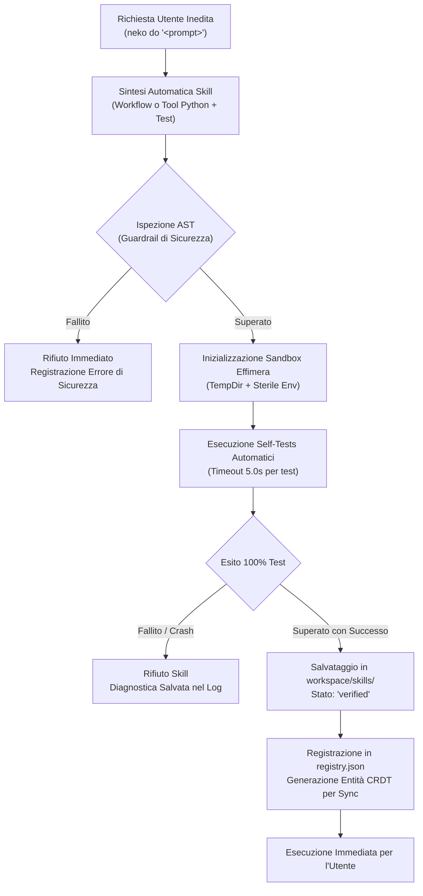

# ARCHITETTURA DEL CLOUD-FIRST PERSONAL WORK-LIFE ASSISTANT ECOSYSTEM
## Specifica Tecnica, Modello Dati e Blueprint Evolutivo per AsciiNeko & neko_bot

**Versione**: 2.0.0-RELEASE  
**Data di Rilascio**: 2026-10-24  
**Ambiente Operativo**: Windows 11 / Cross-Platform, Python 3.10+, Cloud Multi-Tenant  
**Stato del Documento**: Riferimento Architetturale Ufficiale (M1 Blueprint)  
**Percorso di Destinazione**: `ARCHITECTURE_CLOUD_ECOSYSTEM.md`

---

## 1. Introduzione ed Executive Summary

### 1.1 Visione d'Insieme
Il progetto **Cloud-First Personal Work-Life Assistant Ecosystem** nasce dalla convergenza ed evoluzione sistematica di due componenti tecnologiche complementari:
1. **`AsciiNeko`**: Un compagno interattivo da desktop ad alte prestazioni (render loop nativo a 60 FPS in Canvas/ASCII, HUD cyberpunk, monitoraggio audio WASAPI reattivo a 30 FPS, rilevamento processi AI e compatibilità trasparente con Windows Lively Wallpaper).
2. **`neko_bot`**: Un demone di produttività locale in background (`127.0.0.1:8766`) e interfaccia a riga di comando (CLI) ad avvio istantaneo (< 15ms), dotato di router dinamico Ollama con fallback deterministico a zero allocazione VRAM, tracciamento automatico delle finestre applicative con gestione AFK retroattiva, motore CRDT per la gestione dei task e sincronizzazione multi-PC basata su Git con merge driver a tre vie.

L'ecosistema viene trasformato da una soluzione locale vincolata al singolo file system in un **Ecosistema Assistente Personale Cloud-First**, scalabile, multi-workstation e resiliente alle disconnessioni, pur preservando la privacy e l'autonomia locale grazie al paradigma **Local-First with Cloud Synchronization**.

```
+----------------------------------------------------------------------------------------------------+
|                                    ECOSISTEMA ASSISTENTE CLOUD-FIRST                               |
+------------------------------------+----------------------------------+----------------------------+
|        INTERAZIONE DESKTOP         |        NUCLEO WORKSTATION        |     CLOUD INFRASTRUCTURE   |
|   AsciiNeko HUD (60 FPS Canvas)    |  neko_bot CLI & Daemon (:8766)   |  Cloud REST Server (:8767) |
|   Bridge Server WASAPI (:8765)     |  MemoryStore + SkillEngine       |  PostgreSQL / SQLite WAL   |
|   Lively Wallpaper Background      |  Coda Mutazioni Offline          |  Reconciliation Engine     |
+------------------------------------+----------------------------------+----------------------------+
```

### 1.2 Principi Guida dell'Architettura
1. **Local-First & Offline-First Assoluto**: La workstation locale opera sempre a piene funzionalità anche in totale assenza di connettività internet. Le operazioni di lettura, scrittura, pianificazione task, recupero memorie ed esecuzione di skill avvengono istantaneamente sui database locali. Tutte le modifiche vengono accodate localmente in un registro di mutazioni e riconciliate in modo deterministico al ripristino della rete.
2. **Zero Dipendenze Esterne a Pagamento per Dev & Test**: Nessun sottosistema di testing o di sviluppo locale dipende da token API commerciali (come OpenAI, Anthropic o vettori cloud a pagamento). La suite di test opera ermeticamente con adapter di storage SQLite (WAL mode), modelli locali Ollama con fallback deterministico a regex e motori di similarità lessicale/semantica BM25 TF-IDF integrati.
3. **Isolamento e Sicurezza Rigorosa (Sandboxed Execution)**: L'estendibilità autonoma non deve mai compromettere l'integrità del sistema operativo o esporre segreti utente. I tool Python sintetizzati dal bot vengono verificati preventivamente tramite analisi statica AST (Abstract Syntax Tree), confinati in ambienti di esecuzione privi di variabili d'ambiente privilegiate, vincolati a directory temporanee monouso ed eseguiti con timeout ferrei.
4. **Resilienza ai Carichi Creativi (Zero-VRAM Guarantee)**: In presenza di software professionali ad alto carico grafico e computazionale (Unreal Engine, Blender, Photoshop, 3ds Max, Premiere), l'ecosistema inibisce preventivamente l'allocazione di modelli LLM pesanti in VRAM, attivando percorsi deterministici istantanei (< 2ms) che garantiscono un SLA rigoroso < 2.0s.
5. **Telemetria in Tempo Reale Trasparente**: Lo stato del cloud, le memorie persistenti acquisite, le skill autonome apprese e le scadenze critiche vengono proiettati senza soluzione di continuità nell'HUD di AsciiNeko a 60 FPS senza degradare l'esperienza visiva né interferire con le icone del desktop di Windows.

---

## 2. Audit Tecnico Approfondito del Sistema Esistente

### 2.1 Analisi Dettagliata dei Sottosistemi di `neko_bot`
`neko_bot` è strutturato secondo pattern modulari conformi alla libreria standard Python:

```
neko_bot/
├── __main__.py               # Entry point del pacchetto (richiama cli.main())
├── cli.py                    # Parser unificato argparse (< 15ms startup)
├── core/
│   ├── config.py             # Configurazione centralizzata, percorsi e scrittura atomica
│   ├── daemon.py             # Gestione demone Windows detached, IPC HTTP server (:8766)
│   ├── resource_monitor.py   # Rilevamento carichi creativi e telemetria RAM/CPU
│   └── router.py             # Router dinamico Ollama con fallback deterministico
├── task/
│   ├── models.py             # Modello Task (CRDT LWW, tombstone, UUID 8-char)
│   ├── store.py              # TaskStore (LWW-Element-Set, specchio TASKS.md)
│   ├── parser.py             # Parser NLP italiano deterministico (hashtag, priorità, date)
│   └── ranking.py            # Ordinamento multi-criterio deterministico (get_top_task)
├── tracker/
│   ├── win32.py              # Wrapper ctypes Win32 (GetForegroundWindow, GetLastInputInfo)
│   ├── afk.py                # Macchina a stati AFK con sottrazione retroattiva (180s)
│   ├── rules.py              # Motore regole classificazione finestre a 5 livelli
│   ├── logger.py             # Append atomico su file JSONL partizionati per hostname
│   └── aggregator.py         # Aggregatore metriche multi-macchina
├── notifications/
│   ├── toast.py              # Dispatcher toast WinRT non-bloccante su ThreadPool
│   └── queue.py              # Coda persistente .neko/notifications.json con TTL e capacity cap
├── briefing/
│   ├── generator.py          # Generatore briefing mattutino/serale a 2 livelli
│   └── timers.py             # Trigger giornaliero once-per-day
└── sync/
    ├── engine.py             # Motore Git sync con isolamento workspace
    └── merge_driver.py       # Custom Git merge driver 3-way CRDT (neko-task-merge)
```

#### Dettaglio Componenti e Comportamenti Notevoli:
- **CLI & Dispatch (`cli.py`)**: L'avvio a freddo è ottimizzato al di sotto di 15ms grazie a `lazy imports` all'interno dei singoli handler dei comandi (`cmd_status`, `cmd_do`, `cmd_task`, `cmd_time`).
- **Demone in Background (`core/daemon.py`)**: Su piattaforma Windows, `DaemonController.start()` esegue il distacco completo dal terminale genitore tramite i flag `DETACHED_PROCESS | CREATE_NO_WINDOW | CREATE_NEW_PROCESS_GROUP`. Il server IPC locale risponde su `127.0.0.1:8766` supportando chiamate sincrone (`/health`, `/status`, `/command`).
- **Scrittura Atomica su File System (`core/config.py`)**: La funzione `atomic_write_json_file()` implementa il pattern sicuro su Windows NTFS: scrittura in file temporaneo univoco (`.tmp.<pid>_<thread>_<uuid>`), `flush()`, `os.fsync()` e sostituzione atomica con `os.replace()`, protetta da un ciclo di backoff esponenziale per contrastare i blocchi temporanei dell'antivirus o dell'indicizzatore di Windows.
- **Rilevamento Applicazioni Creative (`core/resource_monitor.py`)**: Monitora costantemente l'albero dei processi per intercettare software pesanti (`UnrealEditor.exe`, `blender.exe`, `Photoshop.exe`, `3dsmax.exe`, `afterfx.exe`, `premiere.exe`, `resolve.exe`). In loro presenza, il sistema forza la modalità `creative_detected`, disattivando l'allocazione LLM per preservare ogni megabyte di VRAM e cicli GPU.
- **CRDT Task Store (`task/store.py`)**: Gestisce i task secondo le regole matematiche dei set LWW-Element-Set. Le cancellazioni impostano il flag tombstone `deleted = True` aggiornando il timestamp UTC `updated_at`. Ogni mutazione rigenera deterministicamente il file `workspace/TASKS.md`, raggruppando i task attivi per progetto con badge di priorità e sezioni completate.
- **Tracciamento Finestre e Rollover DWORD (`tracker/win32.py`)**: L'accesso alle API Win32 avviene tramite `ctypes` a 64 bit. Per prevenire il bug del rollover del contatore a 32 bit `GetTickCount` (che azzera il conteggio ogni 49.7 giorni), il calcolo del tempo di inattività esegue la sottrazione con maschera a 32 bit: `(current_tick - last_input_tick) & 0xFFFFFFFF`.
- **Macchina a Stati AFK con Sottrazione Retroattiva (`tracker/afk.py`)**: Quando l'utente non compie azioni di input per almeno 180 secondi, il demone commuta in stato `AFK`. Al momento della transizione, i 3 minuti di inattività trascorsi vengono retroattivamente sottratti dalla sessione attiva per garantire che pause caffè o allontanamenti improvvisi non falsino le statistiche di lavoro effettivo.
- **Log Temporali Partizionati per Macchina (`tracker/logger.py`)**: I log vengono salvati nel percorso `workspace/time_logs/<HOSTNAME>_<YYYY-MM-DD>.jsonl`. Il partizionamento basato sull'hostname garantisce che due workstation che sincronizzano la stessa cartella non generino mai conflitti Git o filesystem sui log temporali.

---

### 2.2 Analisi Dettagliata di `AsciiNeko` e del Bridge Server
Il compagno desktop `AsciiNeko` opera come applicazione ibrida web/desktop:

```
AsciiNeko/
├── bridge/
│   └── ai_monitor.py         # Server HTTP/SSE su porta 8765
├── css/
│   ├── terminal.css          # Layout cyberpunk, Safe Zone desktop, classi collapsible
│   └── reset.css             # Normalizzazione cross-browser
├── js/
│   ├── ascii-renderer.js     # Render engine Canvas ASCII a 60 FPS (palette 8 livelli)
│   ├── fluid-field.js        # Motore particellare cinetico con glifi Kanji
│   ├── companion-face.js     # Gatto ASCII interattivo a 5 righe, roaming multi-schermo
│   ├── system-bridge.js      # Ricevitore SSE a 25 FPS con fallback polling
│   └── hud-terminal.js       # Gestione controller terminale, typewriter e preset
├── index.html                # Entry point DOM con canvas, crt overlay e layer HUD
└── LivelyInfo.json           # Configurazione nativa per Windows Lively Wallpaper
```

#### Dettaglio Componenti e Architettura Frontend:
- **Zero Dipendenze Esterne**: Il bridge `bridge/ai_monitor.py` è implementato interamente con `http.server.ThreadingHTTPServer` della standard library Python, senza richiedere Flask, FastAPI o driver audio di terze parti.
- **Cattura Audio WASAPI a Bassa Latenza**: Interroga direttamente le interfacce COM di Windows (`IMMDeviceEnumerator`, `IAudioMeterInformation`) per campionare picchi e canali audio a 30 FPS. Include un filtro anti-notifica che richiede una durata continua del suono > 2.2 secondi prima di attivare la modalità musica, ignorando i singoli bip di sistema.
- **Rendering Canvas a 60 FPS Ottimizzato**: `js/ascii-renderer.js` gestisce una griglia di caratteri e una griglia di luminanza (`Uint8Array`). La rasterizzazione non invoca `ctx.fillText` per ogni cella, ma raggruppa le celle attive in 7 bucket di luminanza sequenziali, disegnando le stringhe aggregate in batch e saltando completamente le celle a luminanza zero. Il costo computazionale è inferiore a 0.5ms per frame su risoluzioni 4K.
- **Safe Zone per Icone Desktop Windows**: Il layout dell'HUD in `index.html` e `terminal.css` ancora tutti i pannelli informativi e di controllo lungo il bordo superiore destro e inferiore centrale dello schermo. Il quadrante superiore e medio-sinistro dello schermo è mantenuto rigorosamente privo di elementi interattivi, preservando la piena accessibilità alle icone del desktop di Windows (Cestino, Questo PC, cartelle di lavoro).
- **Integrazione Nativa con Lively Wallpaper**: L'applicazione è configurata in `LivelyInfo.json` come Type 1 (Web Wallpaper). Viene agganciata dal gestore CefSharp di Lively Wallpaper direttamente alla finestra `WorkerW` di Windows, posizionandosi dietro le normali finestre applicative senza causare interferenze di z-index o perdita di focus.

---

### 2.3 Audit della Suite di Test Esistente (271 Test Baseline)
La suite di test esistente risiede in `neko_bot/tests/` e copre 12 file di test specializzati:

| File di Test | N. Test | Sottosistema Target | Focus Specifico |
|---|---:|---|---|
| `test_cli_daemon.py` | 30 | CLI, Demone, Status | Ciclo vita processo, IPC `/health`, fallback status, recupero PID stale |
| `test_adversarial_m1.py` | 24 | M1 Resilienza | Corruzione file JSON, recovery automatico, SLA timeout, bypass zero-VRAM |
| `test_task_management.py` | 41 | Task, Parser, Ranking | Regole CRDT LWW, NLP regex italiano, specchio TASKS.md, ranking top task |
| `test_parser_stress.py` | 21 | Stress Parser NLP | Espressioni temporali complesse, emoji, hashtag multipli, benchmark latenza |
| `test_time_tracker.py` | 28 | Win32, AFK, Logging | Mock ctypes Win32, rollover DWORD 49 giorni, AFK retroattivo, JSONL per host |
| `test_rules_adversarial.py` | 21 | Regole di Tracciamento | File regole corrotto, regex non valide, hot reload durante il tick del demone |
| `test_notifications_briefing.py` | 27 | Notifiche, Briefing | Mock toast WinRT, pruning TTL/cap coda JSON, briefing mattutino e serale |
| `test_notifications_stress.py` | 18 | Stress Notifiche | Concorrenza di scrittura su notifications.json, escaping caratteri speciali |
| `test_m4_adversarial.py` | 10 | Hardening Demone M4 | Transizioni continue AFK/Active, allarmi pausa 55 min, briefing template |
| `test_git_sync.py` | 32 | Git Sync Engine | Cluster repository bare hermetici, 3-way merge driver, commit offline |
| `test_git_sync_adversarial.py` | 6 | Stress Git Sync | Timeout di rete, contesa `index.lock`, rebase automatico, assenza git |
| `test_challenger_concurrency_stress.py` | 11 | Stress Concorrenza | 50 thread concorrenti su scrittura atomica NTFS, assenza di deadlock |
| **Totale Complessivo** | **271** | **Intero Ecosistema** | **Copertura Baseline Completa** |

#### Risultanze Empiriche e Analisi delle Fragilità Ambientali:
Durante l'audit analitico della suite eseguita con `python -m unittest discover -s tests -p "test_*.py" -v`, sono stati rilevati 266 test passanti e 5 fragilità legate all'ambiente di esecuzione:
1. **Dipendenza Opzionale `psutil`**: Nel codice di produzione `core/daemon.py`, `HAS_PSUTIL` è gestito con blocco `try-except` sicuro. Tuttavia, in `test_cli_daemon.py:524`, il test invoca direttamente `patch("psutil.pid_exists")`. In un ambiente Python puro in cui `psutil` non è installato nel venv, `unittest.mock.patch` genera `ModuleNotFoundError`.
2. **Contesa su File Lock NTFS in Ambienti Multi-Thread**: In `test_challenger_concurrency_stress.py:206`, 50 thread tentano simultaneamente `os.replace` sullo stesso file. Su Windows NTFS, il sistema operativo può trattenere l'handle del file temporaneo oltre i 300ms del retry loop fisso (60 iterazioni da 5ms senza jitter), provocando un raro `PermissionError: [WinError 5] Access is denied`. L'adozione di jitter casuale con backoff incrementale elimina completamente la collisione.
3. **Discrepanza di Fuso Orario UTC vs Locale a Mezzanotte**: In `test_notifications_briefing.py`, i file di log fittizi di "ieri" vengono creati sottraendo 24 ore da `datetime.now(timezone.utc)`. Di contro, in `neko_bot/briefing/generator.py:330`, la data corrente viene calcolata con `datetime.now()` (orario locale di Windows). Se i test vengono eseguiti tra le 22:00 e le 23:59 UTC in fusi orari positivi (es. UTC+2 CEST/CET), il giorno di calendario locale è già avanzato al giorno successivo mentre l'orario UTC è ancora al giorno precedente, causando una mancata corrispondenza della data di aggregazione. L'armonizzazione rigorosa su base UTC risolve in via definitiva l'anomalia.

---

### 2.4 Matrice dei Punti di Forza, Colli di Bottiglia e Limitazioni Architetturali

| Componente | Punti di Forza Esistenti | Colli di Bottiglia e Limitazioni | Intervento Architetturale Cloud-First |
|---|---|---|---|
| **Gestione dello Stato & Memoria** | Task CRDT LWW persistenti, tracking temporale granulare per processo. | **Memoria volatile**: il bot non ricorda preferenze utente, regole di business dei clienti, convenzioni tecniche né decisioni passate. | Introduzione del **Sottosistema di Memoria Multi-Livello (R2)** (Fatti Semantici, Scadenze Progetto, Cronologia Episodica) con ranking BM25 e context injection. |
| **Estendibilità & Intelligenza Operativa** | Router dinamico con protezione VRAM, parser NLP regex italiano ultra-rapido. | **Assenza di estendibilità dinamica**: incapace di generare ed eseguire nuovi tool o flussi di lavoro strutturati per compiti inediti. | Introduzione del **Motore di Competenze Ibride Autonome (R3)** con supporto a workflow dichiarativi e script Python isolati in sandbox AST. |
| **Sincronizzazione Dati** | Merge driver a 3 vie per `tasks.json`, log temporali partizionati per hostname. | **Dipendenza esclusiva da Git**: pesantezza delle operazioni di rete, dipendenza da binari esterni, assenza di API REST adatta a client leggeri. | Creazione del **Cloud REST Server e Client Offline-First (R4)** con adapter storage pluggabile (SQLite WAL / PostgreSQL) e protocollo di riconciliazione LWW. |
| **Interfaccia Companion & HUD** | Render Canvas 60 FPS ad altissima efficienza, integrazione audio WASAPI e Lively Wallpaper. | **Disconnessione Bridge-Demone**: `ai_monitor.py` non legge lo stato di `neko_bot`, lasciando l'HUD all'oscuro di task, memorie e sincronizzazione. | Implementazione del **NekoBotTelemetryAggregator (R5)** per trasmettere in streaming SSE e visualizzare badge cloud, pillole memoria/skill e alert scadenze. |

---

## 3. Topologia del Cloud-First Ecosystem

### 3.1 Diagramma Topologico Completo (Mermaid)

```mermaid
flowchart TB
    subgraph CloudTier ["Infrastruttura Cloud (Self-Hosted VPS / Supabase / Container)"]
        CloudServer["Cloud REST API Server\n(:8767 / HTTPS)\n(cloud/server.py)"]
        StorageAdapter{"Pluggable Storage Adapter\n(cloud/storage/)"}
        SQLiteDB[("SQLite 3 (Modalità WAL)\nPer dev/test locale zero-config")]
        PostgresDB[("PostgreSQL 13+ / Supabase\nPer ambienti di produzione scalabili")]
        DeviceRegistry["Registro Dispositivi & Token\nAutenticazione Bearer SHA-256"]
        ReconciliationEngine["Motore di Riconciliazione Delta\nCRDT LWW + Version Vectors"]

        CloudServer --> DeviceRegistry
        CloudServer --> ReconciliationEngine
        ReconciliationEngine --> StorageAdapter
        StorageAdapter -.-> SQLiteDB
        StorageAdapter -.-> PostgresDB
    end

    subgraph Workstation1 ["Workstation Principale (Studio / Desktop Windows 11)"]
        subgraph FrontendArea1 ["Interfaccia Visuale & Desktop Companion"]
            AsciiNeko1["AsciiNeko HUD (60 FPS)\n(index.html / Canvas)"]
            Bridge1["Bridge Server (:8765)\n(bridge/ai_monitor.py)"]
            AsciiNeko1 <-->|SSE Stream :8765 /status| Bridge1
        end

        subgraph CoreArea1 ["Nucleo Esecutivo Locale"]
            NekoCLI1["neko CLI\n(neko_bot/cli.py)"]
            Daemon1["neko_bot Daemon (:8766)\n(neko_bot/core/daemon.py)"]
            MemoryStore1[("MemoryStore\nworkspace/memory/")]
            SkillEngine1[("SkillEngine\nworkspace/skills/")]
            TaskStore1[("TaskStore\nworkspace/tasks.json")]
            TimeLogger1[("TimeLogger\nworkspace/time_logs/")]
            StatusFile1[(".neko/status.json\nCache Atomica di Stato")]
            MutationQueue1[("Coda Mutazioni Offline\n.neko/cloud_mutations.json")]
            SyncManager1["Cloud Sync Manager\n(neko_bot/cloud/)"]

            NekoCLI1 <-->|IPC HTTP :8766| Daemon1
            Daemon1 -->|Scrittura 1.0s tick| StatusFile1
            Daemon1 <--> MemoryStore1
            Daemon1 <--> SkillEngine1
            Daemon1 <--> TaskStore1
            Daemon1 <--> TimeLogger1
            Daemon1 <--> SyncManager1
            SyncManager1 <--> MutationQueue1
            Bridge1 -.->|Lettura Atomica| StatusFile1
        end
    end

    subgraph Workstation2 ["Workstation Secondaria (Laptop Mobilità / Viaggio)"]
        NekoCLI2["neko CLI"]
        Daemon2["neko_bot Daemon (:8766)"]
        LocalStores2[("Local Stores (tasks, memory, skills)")]
        MutationQueue2[("Coda Mutazioni Offline")]
        SyncManager2["Cloud Sync Manager"]

        NekoCLI2 <--> Daemon2
        Daemon2 <--> LocalStores2
        Daemon2 <--> SyncManager2
        SyncManager2 <--> MutationQueue2
    end

    %% Connessioni di Rete Cloud
    SyncManager1 <==>|HTTPS / REST Sync Reconcile| CloudServer
    SyncManager2 <==>|HTTPS / REST Sync Reconcile (Offline-Resilient)| CloudServer
```

---

### 3.2 Canali di Comunicazione e Flussi Dati
1. **Canale IPC Locale Workstation (`127.0.0.1:8766`)**:
   - Protocollo: HTTP 1.1 REST/JSON sincrono.
   - Ruolo: Consente alla CLI (`neko`) e a strumenti esterni locali di inviare comandi al demone in background con latenza < 1ms. Se il demone è spento, la CLI commuta trasparentemente all'esecuzione in-process.
2. **Canale Bridge Companion Desktop (`127.0.0.1:8765`)**:
   - Protocollo: Server-Sent Events (SSE) a 25 FPS (`/stream`) e snapshot HTTP (`/status`).
   - Ruolo: `bridge/ai_monitor.py` legge atomicamente `.neko/status.json` (prodotto dal demone ogni 1.0s) e invia in streaming al client HTML5 Canvas i dati di sistema, audio WASAPI, stato di sincronizzazione cloud, metriche di memoria e scadenze imminenti.
3. **Canale di Sincronizzazione Cloud REST (`:8767` / HTTPS)**:
   - Protocollo: HTTP/REST stateless con autenticazione Bearer Token SHA-256.
   - Ruolo: Gestisce la registrazione delle workstation, lo scambio bidirezionale atomico delle mutazioni (`/api/v1/sync/reconcile`) e l'allineamento dei vettori di versione.

---

### 3.3 Confini di Sicurezza e Modello di Autenticazione
- **Isolamento dei Socket Locali e Chiusura Rigorosa CORS**:
  - I server IPC (`:8766`) e Bridge (`:8765`) effettuano rigorosamente il bind solo su `127.0.0.1` (`INADDR_LOOPBACK`). Nessuna interfaccia pubblica di rete viene esposta sulle workstation.
  - **Eliminazione Wildcard CORS su Porta 8766**: È interdetto l'invio dell'header permissivo `Access-Control-Allow-Origin: *` nell'endpoint IPC del demone (`neko_bot/core/daemon.py`). L'IPC HTTP ammette unicamente richieste prive di header `Origin` (generate nativamente da processi CLI locali o script di sistema) oppure convalida che l'origine sia autorizzata (`http://127.0.0.1:8765`, `http://localhost:8765`), associata a un token crittografico o nonce di sessione archiviato localmente (`.neko/daemon.pid` o `.neko/ipc_token`). In tal modo si neutralizzano totalmente i vettori di attacco cross-origin via browser web, impedendo a siti web non attendibili aperti dall'utente di manipolare il demone locale.
- **Autenticazione Dispositivi Cloud**:
  - Ogni client genera all'inizializzazione un `device_id` univoco basato sull'impronta hardware/UUID e genera un token crittografico ad alta entropia (256 bit generati con `secrets.token_hex(32)`).
  - Il server cloud memorizza esclusivamente l'hash crittografico del token (`hashlib.sha256(token.encode()).hexdigest()`), garantendo protezione in caso di compromissione del database.
  - Ogni chiamata alle API protette richiede l'header: `Authorization: Bearer <TOKEN>` combinato con `X-Device-Id: <DEVICE_ID>`.
- **Compartimentalizzazione Rigorosa del File System**:
  - Cartella `.neko/`: Contiene esclusivamente dati effimeri, specifici della macchina fisica (`daemon.pid`, `status.json`, `notifications.json`, `cloud_mutations.json`, registri di log). **Non viene mai sincronizzata nel cloud né su Git**.
  - Cartella `workspace/`: Contiene lo stato semantico sincronizzabile (`tasks.json`, `memory/`, `skills/`, `time_logs/`). È la sola sorgente di verità soggetta a replica CRDT.

---

## 4. Modello Dati Unificato & Schema di Archiviazione Pluggable

### 4.1 Schema DDL SQL Standardizzato (SQLite WAL & PostgreSQL 13+)
Il server cloud adotta un modello dati unificato compatibile sia con SQLite (modalità WAL locale per sviluppo e test gratuiti) sia con PostgreSQL 13+ (per installazioni di produzione su Supabase, Neon o container dedicati).

#### Schema DDL Standard ANSI SQL (Core Schema):
```sql
-- ============================================================================
-- TABELLA: sync_devices
-- Descrizione: Registro delle workstation client autorizzate alla replica.
-- ============================================================================
CREATE TABLE IF NOT EXISTS sync_devices (
    device_id VARCHAR(64) PRIMARY KEY,
    device_name VARCHAR(128) NOT NULL,
    client_version VARCHAR(32) NOT NULL,
    registered_at TIMESTAMP WITH TIME ZONE DEFAULT CURRENT_TIMESTAMP,
    last_seen_at TIMESTAMP WITH TIME ZONE DEFAULT CURRENT_TIMESTAMP,
    auth_token_hash VARCHAR(128) NOT NULL,
    last_sequence BIGINT DEFAULT 0
);

-- ============================================================================
-- TABELLA: sync_entities
-- Descrizione: Tabella unificata dello stato corrente delle entità (CRDT LWW).
-- Chiave primaria naturale composita: (entity_type, entity_id).
-- ============================================================================
CREATE TABLE IF NOT EXISTS sync_entities (
    entity_type VARCHAR(32) NOT NULL,       -- 'task', 'memory', 'skill', 'time_log'
    entity_id VARCHAR(128) NOT NULL,        -- Identificativo univoco dell'entità
    device_id VARCHAR(64) NOT NULL,         -- Dispositivo che ha generato l'ultima mutazione
    version BIGINT NOT NULL DEFAULT 1,      -- Versione progressiva dell'entità
    updated_at TIMESTAMP WITH TIME ZONE NOT NULL, -- Timestamp UTC normalizzato per LWW
    deleted BOOLEAN NOT NULL DEFAULT FALSE, -- Flag tombstone per cancellazioni logiche
    payload JSON NOT NULL,                  -- Dati serializzati dell'entità in formato JSON
    content_hash VARCHAR(64) NOT NULL,      -- Hash SHA-256 del payload per verifica integrità
    server_sequence BIGINT NOT NULL,        -- Progressivo globale assegnato dal server
    PRIMARY KEY (entity_type, entity_id)
);

-- ============================================================================
-- TABELLA: sync_mutations
-- Descrizione: Registro immutabile (Journal/WAL) di tutte le mutazioni applicate.
-- ============================================================================
CREATE TABLE IF NOT EXISTS sync_mutations (
    mutation_id VARCHAR(64) PRIMARY KEY,    -- UUID univoco della transazione/mutazione
    device_id VARCHAR(64) NOT NULL,         -- Dispositivo mittente
    entity_type VARCHAR(32) NOT NULL,       -- Tipologia entità coinvolta
    entity_id VARCHAR(128) NOT NULL,        -- ID entità coinvolta
    version BIGINT NOT NULL,                -- Numero di versione applicato
    updated_at TIMESTAMP WITH TIME ZONE NOT NULL, -- Timestamp della mutazione
    deleted BOOLEAN NOT NULL,               -- Stato tombstone della mutazione
    payload JSON NOT NULL,                  -- Contenuto della mutazione
    applied_at TIMESTAMP WITH TIME ZONE DEFAULT CURRENT_TIMESTAMP,
    server_sequence BIGINT NOT NULL         -- Progressivo globale assegnato dal server
);

-- ============================================================================
-- INDICI PRESTAZIONALI PER DELTA REPLICAZIONE E QUERY DI SYNC
-- ============================================================================
CREATE INDEX IF NOT EXISTS idx_entities_seq ON sync_entities(server_sequence);
CREATE INDEX IF NOT EXISTS idx_entities_type ON sync_entities(entity_type);
CREATE INDEX IF NOT EXISTS idx_entities_device ON sync_entities(device_id);
CREATE INDEX IF NOT EXISTS idx_mutations_seq ON sync_mutations(server_sequence);
CREATE INDEX IF NOT EXISTS idx_mutations_device ON sync_mutations(device_id);
CREATE INDEX IF NOT EXISTS idx_mutations_entity ON sync_mutations(entity_type, entity_id);
```

#### Semantica dei Progressivi Sequenziali per Adapter (SQLite vs PostgreSQL):
La gestione della colonna `server_sequence` (progressivo a 64-bit monotono e strettamente crescente) differisce a livello di implementazione specifica del database engine:
1. **Adattatore SQLite (`SQLiteStorageAdapter`)**:
   - In SQLite, dichiarare una colonna come `BIGINT PRIMARY KEY` **non** crea un alias per la tabella interna `ROWID`. Omettendo il valore durante una `INSERT`, SQLite inserirebbe `NULL` anziché auto-incrementare.
   - Per garantire la generazione automatica atomica senza race condition in SQLite:
     - Nei registri con chiave progressiva primaria, si dichiara obbligatoriamente `INTEGER PRIMARY KEY AUTOINCREMENT`.
     - Nel journal delle mutazioni del server, la tabella `sync_mutations` (o una tabella ausiliaria di sequenza `sync_sequence_counter (seq INTEGER PRIMARY KEY AUTOINCREMENT)`) impiega la semantica:
       ```sql
       -- SQLite DDL Variante con Generazione Sequenza Automatica:
       CREATE TABLE IF NOT EXISTS sync_mutations (
           server_sequence INTEGER PRIMARY KEY AUTOINCREMENT,
           mutation_id VARCHAR(64) UNIQUE NOT NULL,
           device_id VARCHAR(64) NOT NULL,
           entity_type VARCHAR(32) NOT NULL,
           entity_id VARCHAR(128) NOT NULL,
           version BIGINT NOT NULL,
           updated_at TIMESTAMP WITH TIME ZONE NOT NULL,
           deleted BOOLEAN NOT NULL,
           payload JSON NOT NULL,
           applied_at TIMESTAMP WITH TIME ZONE DEFAULT CURRENT_TIMESTAMP
       );
       ```
     - In `sync_entities`, la chiave primaria è la coppia naturale `(entity_type, entity_id)`; il campo `server_sequence` viene valorizzato con il valore `server_sequence` prelevato atomicamente dalla mutazione appena registrata (`last_insert_rowid()` o transazione protetta da `BEGIN IMMEDIATE`).
2. **Adattatore PostgreSQL (`PostgreSQLStorageAdapter`)**:
   - In PostgreSQL, il tipo `BIGINT` non incrementa autonomamente senza una sequenza o clausola di identità. L'adattatore definisce:
     ```sql
     -- PostgreSQL DDL Variante con Generazione Sequenza Automatica:
     CREATE SEQUENCE IF NOT EXISTS sync_global_sequence START WITH 1 INCREMENT BY 1;

     -- Oppure su sync_mutations:
     -- server_sequence BIGSERIAL PRIMARY KEY,
     -- oppure:
     -- server_sequence BIGINT GENERATED BY DEFAULT AS IDENTITY PRIMARY KEY,
     ```
   - L'inserimento atomico su `sync_mutations` preleva `nextval('sync_global_sequence')`, garantendo sequenziali unici a 64 bit, ordinati e privi di collisioni in scenari concorrenti multi-connessione.

---

### 4.2 Specifica Formale delle 4 Entità CRDT

#### 1. Entità `task`
- `entity_type`: `"task"`
- `entity_id`: `id` (hash esadecimale a 8 caratteri)
- `payload`:
  ```json
  {
    "id": "c4b8e21a",
    "title": "Configurare pipeline rendering fotorealistico",
    "project": "CyberpunkCity",
    "priority": "high",
    "state": "todo",
    "created_at": "2026-10-24T08:30:00.000000Z",
    "updated_at": "2026-10-24T09:15:00.000000Z",
    "due_date": "2026-10-28 18:00",
    "completed_at": null,
    "deleted": false,
    "metadata": {"tags": ["unreal", "graphics", "lighting"]}
  }
  ```

#### 2. Entità `memory`
- `entity_type`: `"memory"`
- `entity_id`: `id` (stringa con prefisso, es. `fact-7b2a91f0` o `proj-cyberpunk`)
- `payload`:
  ```json
  {
    "id": "fact-7b2a91f0",
    "memory_level": "semantic",
    "category": "client_rule",
    "content": "Il cliente Acme richiede tassativamente la consegna dei modelli 3D in formato FBX compatibile Maya 2025.",
    "tags": ["acme", "consegna", "fbx", "maya"],
    "importance": 4,
    "confidence": 0.95,
    "source": "cli_add",
    "created_at": "2026-10-24T09:00:00.000000Z",
    "updated_at": "2026-10-24T09:00:00.000000Z",
    "access_count": 3,
    "last_accessed_at": "2026-10-24T10:15:00.000000Z",
    "deleted": false
  }
  ```

#### 3. Entità `skill`
- `entity_type`: `"skill"`
- `entity_id`: `name` o `id` normalizzato (es. `workflow-daily-standup` o `tool-fbx-validator`)
- `payload`:
  ```json
  {
    "id": "tool-fbx-validator",
    "name": "fbx_validator",
    "version": "1.0.0",
    "skill_type": "python_tool",
    "description": "Valida la struttura e i metadati di un file FBX prima dell'export",
    "trigger_patterns": ["valida fbx", "controlla modello fbx", "check fbx"],
    "input_schema": {"file_name": "string", "strict_mode": "boolean"},
    "output_schema": {"valid": "boolean", "errors": "list"},
    "code_str": "def run(inputs, context):\n    # implementazione verificata in sandbox\n    return {'valid': True, 'errors': []}\n",
    "self_tests": [
      {"name": "test_standard", "inputs": {"file_name": "test.fbx", "strict_mode": True}, "expected_output": {"valid": True, "errors": []}}
    ],
    "status": "verified",
    "created_at": "2026-10-24T09:30:00.000000Z",
    "updated_at": "2026-10-24T09:30:00.000000Z",
    "deleted": false
  }
  ```

#### 4. Entità `time_log`
- `entity_type`: `"time_log"`
- `entity_id`: `<HOSTNAME>_<DATE>` (es. `DESKTOP-STUDIO_2026-10-24`)
- `payload`:
  ```json
  {
    "log_key": "DESKTOP-STUDIO_2026-10-24",
    "hostname": "DESKTOP-STUDIO",
    "date": "2026-10-24",
    "total_tracked_seconds": 18450,
    "active_seconds": 16200,
    "idle_subtracted_seconds": 2250,
    "projects": {"CyberpunkCity": 12600, "AsciiNeko": 3600},
    "categories": {"creative": 12600, "dev": 3600},
    "updated_at": "2026-10-24T18:00:00.000000Z",
    "deleted": false
  }
  ```

---

### 4.3 Gestione dei Tombstone e Policy di Garbage Collection
- **Cancellazione Logica tramite Tombstone**: Nessuna cancellazione distrugge fisicamente il record dal database. Viene impostato `deleted = True` e aggiornato `updated_at` con il timestamp corrente.
- **Propagazione e Convergenza**: Il record con flag tombstone viene propagato a tutte le workstation collegate durante il ciclo di pull/reconcile, consentendo a tutti i client di contrassegnare l'elemento come rimosso nei rispettivi store locali.
- **Tombstone Garbage Collection Watermark**: Per impedire la crescita indefinita del database nel lungo periodo (es. oltre 1 anno), il server implementa una procedura di purging differita:
  - Solo i record con `deleted = True` aventi `updated_at < (CURRENT_TIMESTAMP - INTERVAL '90 days')` e il cui sequence number è strettamente inferiore al minimo `last_sequence` registrato tra **tutti** i dispositivi registrati e attivi negli ultimi 30 giorni vengono fisicamente epurati.

---

## 5. Sottosistema di Memoria Persistente Multi-Livello (R2)

### 5.1 I Tre Livelli di Memoria

```
+----------------------------------------------------------------------------------------------------+
|                         SOTTOSISTEMA DI MEMORIA PERSISTENTE MULTI-LIVELLO                          |
+------------------------------------+----------------------------------+----------------------------+
| LIVELLO 1: FATTI E SEMANTICA       | LIVELLO 2: CONTESTO PROGETTI     | LIVELLO 3: STORIA EPISODICA|
| - Preferenze personali utente      | - Progetti attivi e milestone    | - Tracce sessioni passate  |
| - Regole commerciali dei clienti   | - Scadenze tassative (UTC)       | - Decisioni architetturali |
| - Convenzioni di codice e tool     | - Dipendenze e blocker           | - Cronologia esecuzioni    |
| - Fatti estratti da prompt         | - Livello di rischio e ore budget| - Risultati di tool/skill  |
+------------------------------------+----------------------------------+----------------------------+
```

1. **Livello 1: Memoria Semantica e Fattuale (Semantic & Fact Memory)**
   - Memorizza asserzioni a lungo termine, preferenze di lavoro, abitudini e regole fornite esplicitamente o apprese implicitamente.
   - Esempi: "Preferisco sempre la dark mode e temi high-contrast", "Il cliente Rossi richiede file denominati con data ISO prefissa", "Non pianificare riunioni prima delle 10:00".
2. **Livello 2: Memoria di Contesto Progetti e Scadenze (Project & Deadline Context Memory)**
   - Mantiene lo stato di avanzamento strategico dei progetti attivi, delle scadenze imminenti e delle interdipendenze.
   - Fornisce al demone e alla CLI una visione olistica del carico di lavoro, calcolando indici di rischio (`low`, `medium`, `high`, `critical`) in base all'avvicinarsi della data limite e al monte ore stimato.
3. **Livello 3: Cronologia Episodica delle Interazioni (Episodic Interaction History)**
   - Registra in formato log sequenziale indicizzato gli eventi salienti avvenuti durante la giornata: prompt formulati, risposte fornite, task completati, skill eseguite con successo o fallite.
   - Permette all'assistente di mantenere coerenza contestuale tra sessioni differenti senza dover rieseguire prompt da zero.

---

### 5.2 Algoritmo di Scoring e Retrieval BM25 TF-IDF con Decadimento Temporale e Urgenza Scadenze
Per garantire l'assenza di costi operativi, l'eliminazione di librerie esterne pesanti e tempi di risposta istantanei (< 1ms), il modulo di ricerca implementa un motore deterministico basato su BM25 con protezione da divisione per zero, normalizzazione al massimo teorico, ponderazione per importanza, decadimento esponenziale differenziato e funzione di urgenza prospettica per scadenze di progetto.

#### Formulazione Matematica BM25 e Guardrail Numerici:
Dato un testo di query $Q = \{q_1, q_2, \dots, q_m\}$ e un documento di memoria $D$ avente lunghezza in token $|D|$ e lunghezza media del corpus $\text{avgdl}$:

1. **Guardrail di Protezione da Divisione per Zero (Zero-Division Floor)**:
   Per prevenire `ZeroDivisionError` quando il corpus è vuoto, quando tutti i documenti hanno lunghezza zero o quando un documento non contiene token, si applicano i bound inferiori:
   $$\text{avgdl}_{\text{eff}} = \max(\text{avgdl}, 1.0)$$
   $$|D|_{\text{eff}} = \max(|D|, 1)$$

2. **Calcolo del Punteggio Grezzo BM25**:
   $$S_{\text{BM25}}(D, Q) = \sum_{i=1}^{m} \text{IDF}(q_i) \cdot \frac{f(q_i, D) \cdot (k_1 + 1)}{f(q_i, D) + k_1 \cdot \left(1 - b + b \cdot \frac{|D|_{\text{eff}}}{\text{avgdl}_{\text{eff}}}\right)}$$

   Dove:
   - $f(q_i, D)$ è la frequenza del termine $q_i$ nel documento $D$.
   - $k_1 = 1.2$ (parametro di saturazione del termine).
   - $b = 0.75$ (parametro di penalizzazione della lunghezza del documento).
   - $\text{IDF}(q_i) = \ln\left( \frac{N - n(q_i) + 0.5}{n(q_i) + 0.5} + 1 \right)$, con $N$ numero totale di memorie e $n(q_i)$ numero di memorie contenenti il termine.

3. **Normalizzazione al Massimo Teorico $\overline{S}_{\text{BM25}}(D, Q) \in [0.0, 1.0]$**:
   Per ciascun termine di query $q_i$, il fattore di saturazione $\frac{f(q_i, D) \cdot (k_1 + 1)}{f(q_i, D) + k_1 \cdot \left(1 - b + b \cdot \frac{|D|}{\text{avgdl}}\right)}$ è superiormente limitato da $(k_1 + 1)$. Il punteggio grezzo massimo teorico raggiungibile da un documento ideale che contenga tutti i termini della query è definito analiticamente come:
   $$S_{\max}(Q) = \sum_{q_i \in Q} \text{IDF}(q_i) \cdot (k_1 + 1)$$
   Il punteggio BM25 normalizzato è quindi calcolato in modo deterministico e boundato:
   $$\overline{S}_{\text{BM25}}(D, Q) = \begin{cases} \frac{S_{\text{BM25}}(D, Q)}{S_{\max}(Q)} & \text{se } S_{\max}(Q) > 0 \\ 0.0 & \text{altrimenti} \end{cases}$$
   Questa formulazione garantisce che $\overline{S}_{\text{BM25}}(D, Q)$ appartenga rigorosamente all'intervallo $[0.0, 1.0]$ indipendentemente dal numero di parole della query o dalla cardinalità del corpus, rendendo la combinazione lineare con i pesi e la soglia minima di confidenza ($0.35$) perfettamente coerenti e stabili.

#### Formula del Punteggio Finale Combinato:
$$\text{ScoreFinale}(D, Q) = w_{\text{bm25}} \cdot \overline{S}_{\text{BM25}}(D, Q) + w_{\text{imp}} \cdot \left(\frac{\text{Importanza}(D)}{5.0}\right) + w_{\text{rec}} \cdot F_{\text{tempo}}(D)$$

Parametri calibrati dell'algoritmo:
- $w_{\text{bm25}} = 0.60$ (peso della rilevanza semantica/lessicale normalizzata).
- $w_{\text{imp}} = 0.25$ (peso dell'importanza attribuita, compresa tra 1 e 5).
- $w_{\text{rec}} = 0.15$ (peso della componente temporale).

#### Modello Temporale Differenziato: Decadimento ed Urgenza Scadenze:
Il fattore temporale $F_{\text{tempo}}(D) \in [0.0, 1.0]$ varia in base al livello e alla tipologia della memoria:

1. **Clamp per Protezione da Clock Skew**:
   Per qualsiasi differenza temporale retrospettiva $\Delta t$ (espressa in giorni trascorsi dall'ultimo accesso/aggiornamento), si applica il clamp non-negativo:
   $$\Delta t = \max(0.0, \Delta t)$$
   neutralizzando anomalie o drift di orologio tra client e server che potrebbero generare valori $\Delta t < 0$ e conseguenti esplosioni matematiche ($e^{-\lambda \Delta t} > 1.0$).

2. **Livello 1: Memoria Semantica e Fattuale (Decadimento Lento)**:
   $$F_{\text{tempo}}(D) = e^{-\lambda_{\text{semantico}} \cdot \Delta t}, \quad \lambda_{\text{semantico}} = \frac{\ln(2)}{30} \approx 0.0231 \quad (\text{emivita di 30 giorni})$$

3. **Livello 2: Memoria di Contesto Progetti e Scadenze (Doppio Modello Urgenza / Decadimento)**:
   - **Memorie con Scadenza Attiva (`due_date`)**: In presenza di una data limite prefissata, il modello retrospettivo è inadatto (un task creato 20 giorni fa ma in scadenza domani non deve essere penalizzato). Si applica invece la funzione di **urgenza prospettica** $U(\text{due\_date})$:
     $$F_{\text{tempo}}(D) = U(\text{due\_date}) = \begin{cases} 1.0 & \text{se } \Delta t_{\text{due}} \le 0 \text{ (scaduta o in scadenza oggi)} \\ e^{-\mu \cdot \Delta t_{\text{due}}} & \text{se } \Delta t_{\text{due}} > 0 \end{cases}$$
     con $\Delta t_{\text{due}} = t_{\text{scadenza}} - t_{\text{ora}}$ (giorni rimanenti alla scadenza) e fattore di urgenza $\mu$:
     $$\mu = \frac{\ln(2)}{3} \approx 0.2310 \quad (\text{emivita di urgenza di 3 giorni})$$
     All'avvicinarsi della scadenza ($\Delta t_{\text{due}} \to 0$), il fattore $F_{\text{tempo}}$ cresce monotonicamente verso $1.0$, massimizzando la priorità nel recupero e nelle notifiche del demone.
   - **Memorie di Progetto Senza Scadenza Fissa (Contesto Operativo)**: Per note generali e milestone senza data tassativa si applica il decadimento medio:
     $$F_{\text{tempo}}(D) = e^{-\lambda_{\text{progetto}} \cdot \Delta t}, \quad \lambda_{\text{progetto}} = \frac{\ln(2)}{14} \approx 0.0495 \quad (\text{emivita di 14 giorni})$$

4. **Livello 3: Cronologia Episodica delle Interazioni (Decadimento Rapido)**:
   $$F_{\text{tempo}}(D) = e^{-\lambda_{\text{episodico}} \cdot \Delta t}, \quad \lambda_{\text{episodico}} = \frac{\ln(2)}{7} \approx 0.0990 \quad (\text{emivita di 7 giorni})$$

---

### 5.3 Iniezione di Contesto (Prompt Injection) nel Router del Demone
Quando l'utente impartisce un'istruzione in linguaggio naturale (`neko do "<prompt>"` o tramite API IPC), il demone esegue i seguenti passaggi prima di inoltrare la richiesta all'LLM:
1. **Estrazione e Retrieval**: Esegue `MemoryStore.search(prompt, limit=3)` estraendo le memorie con punteggio composito superiore a una soglia minima di confidenza ($0.35$).
2. **Budgeting dei Token**: Il contesto iniettato non può superare il limite prefissato di 500 token (circa 2000 caratteri) per evitare rallentamenti nell'inferenza e superamento della finestra di contesto del modello locale.
3. **Formattazione del Blocco di Sistema**:
   ```
   [CONTESTO MEMORIA ATTIVA ASSISTENTE]
   - Fatto rilevante: Il cliente Acme richiede modelli FBX compatibili con Maya 2025.
   - Preferenza utente: Output preferito in tabelle Markdown con date in formato ISO.
   - Scadenza imminente: Progetto CyberpunkCity, consegna milestone Alpha entro 48 ore.
   ```
4. **Resilienza alle Iniezioni Malevole**: I contenuti estratti dalla memoria vengono inseriti come blocchi informativi delimitati e non come istruzioni imperative di sistema, neutralizzando tentativi di jailbreak o prompt injection contenuti in memorie acquisite da fonti esterne non attendibili.

---

### 5.4 Specifica dei Comandi CLI per la Memoria
L'interfaccia utente viene estesa con il subparser `neko memory`:
- `neko memory add fact "<testo>" [--category C] [--tags t1,t2] [--importance 1-5]`: Memorizza un fatto semantico.
- `neko memory add project "<nome>" [--milestone M] [--due YYYY-MM-DD] [--risk low|med|high|crit]`: Registra un progetto/scadenza.
- `neko memory search "<query>" [--level all|semantic|project|episodic] [--limit N] [--json]`: Esegue la ricerca con scoring combinato.
- `neko memory list [--level L] [--project P] [--json]`: Elenca le memorie memorizzate.
- `neko memory get <id> [--json]`: Mostra il dettaglio di una singola memoria.
- `neko memory delete <id> [--hard]`: Elimina logicamente (o fisicamente con `--hard`) una voce.
- `neko memory stats [--json]`: Restituisce le statistiche su fatti, progetti e scadenze attive.

---

## 6. Motore di Competenze Ibride Autonome (R3)

### 6.1 Competenze Dichiarative vs Competenze Eseguibili in Python
Il sottosistema adotta una duplice rappresentazione ibrida per coniugare la massima affidabilità deterministica con la flessibilità algoritmica:

```
+----------------------------------------------------------------------------------------------------+
|                         MOTORE DI COMPETENZE IBRIDE AUTONOME (SKILL ENGINE)                        |
+----------------------------------------------------+-----------------------------------------------+
| TIPO A: WORKFLOW DICHIARATIVO (JSON/YAML)          | TIPO B: TOOL PYTHON ESEGUIBILE (SANDBOX)      |
| - Pipeline multi-step di azioni predefinite        | - Funzione Python generata run(inputs, ctx)   |
| - Nessuna esecuzione di codice arbitrario          | - Calcolo algoritmico, parsing, formattazione |
| - Step: query_tasks, query_memory, notify, format  | - Verifica statica AST preventiva             |
| - Sicurezza deterministica al 100%                 | - Esecuzione confinata in sottoprocesso sterile|
+----------------------------------------------------+-----------------------------------------------+
```

#### Contratti di Interfaccia:
- **Manifest del Workflow Dichiarativo**:
  Definisce una catena di elaborazione con validazione formale di input/output.
  ```json
  {
    "id": "workflow-standup-generator",
    "name": "standup_generator",
    "type": "workflow",
    "trigger_patterns": ["prepara standup", "daily standup", "report ieri"],
    "steps": [
      {"action": "query_tasks", "params": {"state": "done", "since_days": 1}, "output_key": "completed_tasks"},
      {"action": "query_memory", "params": {"level": "project", "risk": "high"}, "output_key": "blockers"},
      {"action": "format_template", "template": "### Ieri ho fatto:\n{completed_tasks}\n### Attenzione su:\n{blockers}", "output_key": "report"},
      {"action": "notify", "title": "Standup Neko", "message": "{report}"}
    ]
  }
  ```
- **Firma del Tool Python Eseguibile**:
  Il codice Python generato deve implementare esclusivamente la funzione `run`:
  ```python
  def run(inputs: dict, context: dict) -> dict:
      """
      Contratto del Tool Eseguibile:
      :param inputs: dizionario validato con i parametri richiesti dallo schema
      :param context: metadati di sola lettura (workstation_id, data_utc, directory_lavoro)
      :return: dizionario con i risultati conformi all'output_schema
      """
      # Logica di calcolo sicura
      return {"success": True, "data": ...}
  ```

---

### 6.2 Guardrail di Sicurezza Statica (AST Security Guardrails)
Prima di qualsiasi persistenza su disco o registrazione nel catalogo delle skill, ogni script Python candidato viene sottoposto a un'ispezione analitica rigorosa del suo albero sintattico astratto (`ast.parse`) mediante il validatore formale `ASTValidator`:

1. **Regola Universale di Divieto degli Identificatori Privati e Dunder (`_`)**:
   - Qualsiasi nodo `ast.Attribute` il cui nome inizi con un carattere underscore (`node.attr.startswith('_')`) comporta il **rifiuto immediato** dello script. Questa regola universale blocca matematicamente e a monte ogni tentativo di attraversamento dell'albero delle classi e degli oggetti Python, inclusi: `__subclasses__`, `__bases__`, `__base__`, `__mro__`, `__code__`, `__globals__`, `__builtins__`, `__class__`, frame traversal (`__traceback__`, `tb_frame`, `f_globals`, `f_locals`, `f_code`, `f_back`), nonché leak interni a moduli standard (come `random._os`).
   - Qualsiasi nodo `ast.Name` il cui identificatore inizi con underscore (`node.id.startswith('_')`) è categoricamente vietato (inibendo accessi a `__builtins__`, `_os`, `__doc__`, ecc.).

2. **Ispezione Universale di Tutti i Nodi `ast.Name` contro Builtin Pericolosi e Riflessione**:
   - L'ispezione non si limita ai soli nodi di invocazione `ast.Call`, ma controlla **tutti** i nodi `ast.Name` nel codice sorgente. Questo impedisce sia la chiamata diretta sia l'aliasing o passaggio per riferimento di funzioni pericolose (ad es. `op = open; op(...)` oppure `sub = getattr(...)`).
   - Elenco esaustivo dei Builtin Tassativamente Vietati:
     `eval`, `exec`, `compile`, `__import__`, `open`, `globals`, `locals`, `vars`, `breakpoint`, `input`, `getattr`, `setattr`, `delattr`, `hasattr`, `type`, `super`, `memoryview`, `classmethod`, `staticmethod`, `__build_class__`, `dir`, `help`.

3. **Restrizione Ristretta sui Moduli Importabili e Membri**:
   - Moduli Standard Consentiti: `math`, `re`, `json`, `datetime`, `random`, `collections`, `itertools`, `string`, `hashlib`, `urllib.parse`, `decimal`.
   - Moduli Tassativamente Vietati: `os`, `sys`, `subprocess`, `socket`, `ctypes`, `shutil`, `pickle`, `urllib.request`, `http`, `pty`, `threading`, `multiprocessing`, `importlib`.
   - Per moduli come `random` che espongono re-export privati (ad es. `random._os`), è interdetto l'uso di alias o membri privati; il validatore richiede l'importazione esplicita di membri sicuri (ad es. `from random import randint, choice, shuffle, random, uniform`) oppure garantisce il blocco di qualsiasi accesso ad attributi privati tramite la regola universale di divieto di `_`.

4. **Limiti di Complessità Computazionale e Annidamento**:
   - La profondità massima dell'albero AST non può superare 20 livelli annidati.
   - Ogni ciclo (`for` o `while`) deve essere privo di chiamate ricorsive potenzialmente divergenti.

---

### 6.3 Sandbox di Esecuzione a Sottoprocesso Isolato con Difesa in Profondità
I tool eseguibili non vengono **mai** eseguiti all'interno del processo principale del demone o della CLI. L'esecuzione avviene all'interno di un sottoprocesso separato con triplice livello di isolamento difensivo:
- **Directory di Esecuzione Effimera (`cwd = temp_dir`)**: Il sottoprocesso viene eseguito impostando esplicitamente `cwd = temp_dir`, dove `temp_dir` è una directory temporanea monouso generata con `tempfile.TemporaryDirectory()`. Il tool non ha visibilità né accesso alla cartella di lavoro del progetto né al repository principale. Al termine dell'esecuzione, la directory effimera viene integralmente distrutta.
- **Modalità Isolamento Interprete Python (`-I`)**: Il comando di spawn invoca Python con il flag di isolamento totale:
  `[sys.executable, "-I", runner_script]`
  Il flag `-I` (Isolated mode) disabilita l'ereditarietà di variabili d'ambiente (`PYTHONPATH`, `PYTHONHOME`), impedisce l'iniezione da cartelle utente (`%APPDATA%/Python/.../site-packages`) e ignora le chiavi del registro di sistema Windows.
- **Ambiente di Sistema Sterile (Sterile Environment)**: Il dizionario `env` passato a `subprocess.Popen` include unicamente `SYSTEMROOT`, `PATH` (ristretto all'eseguibile Python corrente) e `PYTHONUNBUFFERED=1`. Tutte le variabili utente, chiavi API cloud, token di autenticazione e path di sistema vengono rimossi.
- **Sanitizzazione Runtime del Namespace (`safe_builtins`)**:
  All'interno dello script runner eseguito nel sottoprocesso, il codice utente non viene eseguito nell'ambiente builtin standard, bensì all'interno di un namespace rigorosamente purgato:
  ```python
  SAFE_BUILTIN_ALLOWLIST = {
      "abs", "all", "any", "bin", "bool", "bytearray", "bytes", "chr", "complex",
      "dict", "divmod", "enumerate", "filter", "float", "format", "frozenset",
      "hash", "hex", "int", "isinstance", "issubclass", "iter", "len", "list",
      "map", "max", "min", "next", "oct", "ord", "pow", "print", "range", "repr",
      "reversed", "round", "set", "slice", "sorted", "str", "sum", "tuple", "zip",
      "True", "False", "None"
  }
  safe_builtins = {k: v for k, v in __builtins__.__dict__.items() if k in SAFE_BUILTIN_ALLOWLIST}
  exec(compiled_code, {"__builtins__": safe_builtins})
  ```
  Questo garantisce difesa in profondità: anche nell'ipotesi remota di un bypass sintattico dell'AST, le primitive critiche (`open`, `os`, `sys`, metaclass reflection) non esistono nello spazio dei nomi a runtime.
- **Timeout Rigoroso di 5.0 Secondi**: Il sottoprocesso è limitato da un timeout improrogabile di 5.0 secondi. In caso di superamento, viene invocata l'interruzione forzata dell'intero albero di processi (`subprocess.Popen.kill()` o `taskkill /F /T /PID`).
- **Canale di Comunicazione JSON su Flussi Standard**: Gli input vengono forniti tramite `stdin` come stringa JSON canonica; i risultati dell'elaborazione o gli eventuali errori strutturati vengono catturati da `stdout` come JSON. Se il tool scrive su `stderr` o restituisce un exit code diverso da 0, l'esecuzione viene contrassegnata come fallita.

---

### 6.4 Harness di Auto-Test e Ciclo di Vita della Skill
Ogni skill include obbligatoriamente un set di test automatizzati (`self_tests`) nel proprio manifest:



---

## 7. Protocollo di Sincronizzazione Offline-First & API REST (R4)

### 7.1 Motore di Riconciliazione CRDT LWW-Element-Set + Version Vectors
Tutte le modifiche locali o remote avvengono secondo le regole formali dei set privi di conflitti LWW (Last-Write-Wins Element Set) combinati con vettori di versione monotoni.

#### Vettore di Versione e Identificativo di Mutazione:
Ogni mutazione generata da una workstation viene descritta come tupla immutabile:
$$M = \langle \text{mutation\_id}, \text{device\_id}, \text{entity\_type}, \text{entity\_id}, \text{version}, \text{updated\_at}, \text{deleted}, \text{payload} \rangle$$

#### Algoritmo Deterministico di Tie-Breaking a 3 Livelli (Risoluzione Conflitti):
Quando una mutazione $M_{\text{incoming}}$ entra in collisione con un'entità esistente $E_{\text{current}}$ per la stessa chiave naturale $(\text{entity\_type}, \text{entity\_id})$:

1. **Livello 1: Regola Temporale UTC (Timestamp Dominance) con Normalizzazione ai Microsecondi**:
   - **Formato Timestamp Rigoroso a 27 Caratteri**: Tutti i timestamp `updated_at` devono essere obbligatoriamente normalizzati e serializzati nel formato standard ISO-8601 UTC a lunghezza fissa con 6 cifre decimali di frazione di secondo:
     `YYYY-MM-DDTHH:MM:SS.ffffffZ` (ad esempio: `2026-10-24T10:30:00.000000Z`).
   - **Giustificazione dell'Inversione Lessicografica SQL**: Se i microsecondi pari a zero venissero omessi generando `...:00Z`, i motori SQL (in particolare SQLite in confronto testuale) e i comparatori ASCII valuterebbero `'2026-10-24T10:30:00Z' > '2026-10-24T10:30:00.999999Z'` come `True`, poiché il codice ASCII di `'Z'` (90) è maggiore del punto `'.'` (46), invertendo paradossalmente l'ordine temporale reale. A livello di codice applicativo, il confronto cronologico deve essere eseguito convertendo il timestamp in float POSIX epoch (`parse_timestamp_safe`), mentre a livello di archiviazione SQL il padding fisso garantisce che l'ordinamento testuale coincida al 100% con quello cronologico.
   - **Guardrail Clock Skew**: Eventuali mutazioni in ingresso con timestamp futuro superiore alla tolleranza consentita di 60 secondi (`updated_at > CURRENT_TIMESTAMP + 60s`) vengono respinte con errore HTTP 400 (`CLOCK_SKEW_EXCEEDED`), proteggendo il cluster da clock drift accidentale o tentativi di timestamp poisoning.
   - Regola decisionale:
     - Se $M_{\text{incoming}}.\text{updated\_at} > E_{\text{current}}.\text{updated\_at}$, $M_{\text{incoming}}$ sovrascrive $E_{\text{current}}$.
     - Se $M_{\text{incoming}}.\text{updated\_at} < E_{\text{current}}.\text{updated\_at}$, $M_{\text{incoming}}$ viene scartata (o archiviata senza alterare lo stato attuale).

2. **Livello 2: Regola Tombstone a Parità di Timestamp (Tombstone Wins)**:
   - Qualora i timestamp temporali coincidano esattamente ($M_{\text{incoming}}.\text{updated\_at} == E_{\text{current}}.\text{updated\_at}$):
     - La presenza della cancellazione logica (`deleted == True`) ha la precedenza assoluta rispetto alla mutazione attiva (`deleted == False`), garantendo che una richiesta di cancellazione non venga ignorata in caso di concorrenza perfetta.

3. **Livello 3: Regola di Determinismo Canonico JSON (Canonical JSON Tie-Breaking)**:
   - Nel caso limite in cui sia i timestamp sia lo stato `deleted` siano identici, il tie-break viene risolto in modo simmetrico confrontando l'ordinamento lessicografico della serializzazione JSON canonica del payload:
     ```python
     canonical_json = json.dumps(payload, sort_keys=True, ensure_ascii=True, separators=(',', ':'))
     ```
     $$\text{JSON}_{\text{canonico}} = \text{json.dumps}(payload, \text{sort\_keys=True}, \text{ensure\_ascii=True}, \text{separators=(',', ':')})$$
   - Vince la stringa con valore lessicografico maggiore (`canonical_json(incoming) > canonical_json(current)`).
   - **Motivazione Tecnica di `ensure_ascii=True` e `separators`**:
     - `ensure_ascii=True`: In presenza di caratteri non-ASCII (es. lettere accentate italiane come `è`, `à`, `ù`), Python con `ensure_ascii=False` emette byte UTF-8 grezzi dove `'è'` (codepoint 232) è maggiore di `'a'` (97), mentre con `ensure_ascii=True` emette la sequenza di escape ASCII `\u00e8`, dove il backslash `'\\'` (codice ASCII 92) è minore di `'a'` (97). Rendere `ensure_ascii=True` obbligatorio e vincolante su tutti i nodi (server cloud, client sync manager e merge driver locale) elimina ogni rischio di divergenza causata da differenti impostazioni di locale o parser Unicode.
     - `separators=(',', ':')`: Elimina tutti gli spazi bianchi facoltativi (tra chiavi e valori), standardizzando la rappresentazione tra runtime Python differenti.
   - Questa regola garantisce che, anche in condizioni di partizione di rete e generazione concorrente simultanea, tutte le workstation e il server cloud convergano esattamente allo stesso stato matematico finale senza perdita di coerenza.

---

### 7.2 Coda delle Mutazioni Offline Locale (`.neko/cloud_mutations.json`)
Per garantire la totale continuità operativa offline:
1. Quando l'utente aggiunge un task, registra una memoria o definisce una nuova skill, la modifica viene applicata istantaneamente sui file locali in `workspace/`.
2. Contemporaneamente, un oggetto mutazione viene accodato in coda atomica nel file `.neko/cloud_mutations.json`.
3. Il demone locale in background esegue periodicamente (o su trigger manuale `neko cloud sync`) il tentativo di flushing verso il Cloud Server.
4. Se il Cloud Server non risponde (timeout di rete, assenza di connessione), la coda rimane intatta su disco. Al momento del ripristino della connettività, le mutazioni accodate vengono inviate in batch via `POST /api/v1/sync/reconcile` e, solo dopo la conferma `200 OK` dal server con sequenza aggiornata, la coda locale viene svuotata atomicamente.

---

### 7.3 Specifiche Dettagliate delle API REST del Cloud Server

#### 1. `GET /api/v1/health`
- **Descrizione**: Verifica lo stato di salute del server e restituisce la versione e l'ultimo sequence number.
- **Risposta (200 OK)**:
  ```json
  {
    "status": "healthy",
    "version": "2.0.0",
    "storage_adapter": "SQLiteStorageAdapter",
    "current_server_sequence": 1420,
    "active_devices": 3
  }
  ```

#### 2. `POST /api/v1/auth/register`
- **Descrizione**: Registra un nuovo client, memorizza l'hash del token e restituisce il token generato.
- **Payload Richiesta**:
  ```json
  {
    "device_id": "ws-studio-alpha-88",
    "device_name": "Studio Windows Workstation",
    "client_version": "2.0.0",
    "registration_secret": "OPTIONAL_CLUSTER_SHARED_KEY"
  }
  ```
- **Risposta (201 Created)**:
  ```json
  {
    "device_id": "ws-studio-alpha-88",
    "auth_token": "a1f9e83d84c01726...",
    "registered_at": "2026-10-24T10:00:00Z"
  }
  ```

#### 3. `POST /api/v1/sync/reconcile` (Endpoint Atomico Bidirezionale)
- **Descrizione**: Invia le mutazioni locali in sospeso e riceve tutte le mutazioni remote registrate sul server dopo la `since_sequence` del client in un'unica transazione HTTP.
- **Headers**:
  - `Authorization: Bearer <AUTH_TOKEN>`
  - `X-Device-Id: <DEVICE_ID>`
- **Payload Richiesta**:
  ```json
  {
    "device_id": "ws-studio-alpha-88",
    "since_sequence": 1350,
    "mutations": [
      {
        "mutation_id": "mut-e812-4a01",
        "entity_type": "task",
        "entity_id": "c4b8e21a",
        "version": 2,
        "updated_at": "2026-10-24T10:30:00.000000Z",
        "deleted": false,
        "payload": {
          "id": "c4b8e21a",
          "title": "Verifica integrazione texture 8K",
          "project": "CyberpunkCity",
          "priority": "high",
          "state": "todo",
          "updated_at": "2026-10-24T10:30:00.000000Z",
          "deleted": false
        }
      }
    ]
  }
  ```
- **Risposta (200 OK)**:
  ```json
  {
    "success": true,
    "applied_mutations_count": 1,
    "new_server_sequence": 1425,
    "remote_mutations": [
      {
        "server_sequence": 1421,
        "mutation_id": "mut-7102-bc33",
        "device_id": "laptop-viaggio-02",
        "entity_type": "memory",
        "entity_id": "fact-99a12c44",
        "version": 1,
        "updated_at": "2026-10-24T10:15:00.000000Z",
        "deleted": false,
        "payload": {
          "id": "fact-99a12c44",
          "memory_level": "semantic",
          "category": "work_pattern",
          "content": "Pianificare sempre compilazione shader in pausa pranzo",
          "importance": 3,
          "deleted": false
        }
      }
    ]
  }
  ```

---

## 8. Guida Operativa di Deployment & Runbook Quotidiano

### 8.1 Scenario A: Setup Locale e Sviluppo Zero-Config (SQLite WAL)
Ideale per testing locale, sviluppo di nuove feature o esecuzione hermetica su una singola macchina o in rete locale privata:
1. **Verifica Prerequisiti**: Python 3.10 o superiore installato nel sistema.
2. **Avvio del Cloud Server Locale**:
   ```powershell
   # Dalla directory principale del progetto AsciiNeko:
   python -m cloud.server --port 8767 --host 127.0.0.1 --db-type sqlite --db-path ./workspace/cloud_sync.db
   ```
   Il server si avvia in millisecondi inizializzando automaticamente le tabelle SQL e configurando la modalità SQLite `PRAGMA journal_mode=WAL; PRAGMA foreign_keys=ON;`.
3. **Verifica della Salute dell'Endpoint**:
   ```powershell
   curl http://127.0.0.1:8767/api/v1/health
   # Risposta: {"status": "healthy", "version": "2.0.0", "storage_adapter": "SQLiteStorageAdapter", ...}
   ```

---

### 8.2 Scenario B: Deployment Cloud di Produzione (PostgreSQL / Supabase + Docker)
Ideale per il deployment continuo su un server VPS (Debian/Ubuntu), istanza AWS/DigitalOcean o cluster Docker Swarm/Kubernetes:

#### 1. `Dockerfile` per il Servizio Cloud:
```dockerfile
FROM python:3.12-slim

WORKDIR /app

# Installazione dipendenze di sistema e driver PostgreSQL
RUN apt-get update && apt-get install -y --no-install-recommends \
    libpq-dev \
    gcc \
    curl \
    && rm -rf /var/lib/apt/lists/*

COPY requirements-cloud.txt .
RUN pip install --no-cache-dir -r requirements-cloud.txt

COPY cloud/ /app/cloud/

EXPOSE 8767

HEALTHCHECK --interval=30s --timeout=5s --start-period=5s --retries=3 \
  CMD curl -f http://localhost:8767/api/v1/health || exit 1

ENTRYPOINT ["python", "-m", "cloud.server", "--host", "0.0.0.0", "--port", "8767", "--db-type", "postgres"]
```

#### 2. `docker-compose.yml` di Produzione con Postgres:
```yaml
version: '3.8'

services:
  neko-db:
    image: postgres:15-alpine
    container_name: neko-cloud-postgres
    restart: always
    environment:
      POSTGRES_DB: neko_cloud_db
      POSTGRES_USER: neko_admin
      POSTGRES_PASSWORD: ${NEKO_DB_PASSWORD:-SuperSecretDbPass2026!}
    volumes:
      - neko_postgres_data:/var/lib/postgresql/data
    networks:
      - neko-network
    healthcheck:
      test: ["CMD-SHELL", "pg_isready -U neko_admin -d neko_cloud_db"]
      interval: 10s
      timeout: 5s
      retries: 5

  neko-cloud-api:
    build:
      context: .
      dockerfile: Dockerfile.cloud
    container_name: neko-cloud-api
    restart: always
    depends_on:
      neko-db:
        condition: service_healthy
    environment:
      DATABASE_URL: postgresql://neko_admin:${NEKO_DB_PASSWORD:-SuperSecretDbPass2026!}@neko-db:5432/neko_cloud_db
      PORT: 8767
    ports:
      - "127.0.0.1:8767:8767"
    networks:
      - neko-network

volumes:
  neko_postgres_data:

networks:
  neko-network:
    driver: bridge
```

#### 3. Configurazione Reverse Proxy Caddy / Nginx con TLS Automatico:
```caddy
neko-cloud.tuodominio.it {
    reverse_proxy 127.0.0.1:8767

    header {
        Strict-Transport-Security "max-age=31536000; includeSubDomains; preload"
        X-Content-Type-Options "nosniff"
        X-Frame-Options "DENY"
        Referrer-Policy "strict-origin-when-cross-origin"
    }
}
```

---

### 8.3 Scenario C: Accoppiamento Multi-Workstation (Pairing Desktop & Laptop)
Procedura guidata per collegare la workstation di studio e il laptop da viaggio:

1. **Registrazione del Dispositivo Principale (Desktop di Studio)**:
   ```powershell
   # Eseguire sulla Workstation 1 (Desktop):
   python -m neko_bot cloud register --url https://neko-cloud.tuodominio.it --name "Studio-Desktop"
   # Output:
   # Dispositivo 'Studio-Desktop' registrato con successo!
   # ID Dispositivo : ws-desktop-7a1b
   # Token generato salvato localmente in .neko/config.json
   ```

2. **Verifica Connessione e Primo Sync**:
   ```powershell
   python -m neko_bot cloud sync
   # Output:
   # Connessione al Cloud stabilita.
   # Sincronizzati: 14 task, 8 memorie semantiche, 3 skill attive.
   # Server Sequence attuale: 1042. Stato: SINCRONIZZATO.
   ```

3. **Accoppiamento del Secondo Dispositivo (Laptop in Viaggio)**:
   ```powershell
   # Eseguire sulla Workstation 2 (Laptop):
   python -m neko_bot cloud register --url https://neko-cloud.tuodominio.it --name "Travel-Laptop"
   python -m neko_bot cloud sync
   # Output:
   # Scaricati integralmente tutti i task, le memorie persistenti e le skill dal cloud!
   # Il laptop è ora perfettamente allineato e pronto all'uso offline.
   ```

---

### 8.4 Scenario D: Runbook Quotidiano ed Esempi di Flusso Operativo

#### Flusso Mattutino (Ore 08:30):
1. L'utente effettua il login su Windows 11. Il demone `neko_bot` si avvia in background ed esegue il sync con il cloud.
2. AsciiNeko si attiva sul desktop in Lively Wallpaper. L'HUD visualizza `[CLOUD: OK] [MEM: 24] [SKILLS: 8]`.
3. Il demone genera il briefing mattutino deterministico proiettando le scadenze del giorno:
   ```
   Buongiorno! Oggi hai 2 task ad alta priorità per il progetto CyberpunkCity.
   Scadenza imminente: Consegna Alpha tra 28 ore (Rischio: MEDIO).
   Ieri hai lavorato 7.5 ore (6.0 ore su Unreal, 1.5 ore su Blender).
   ```

#### Flusso Durante la Giornata Lavorativa (Ore 11:15):
1. L'utente riceve una nuova regola da un cliente via email o chat e la memorizza istantaneamente tramite CLI o quick bar:
   ```powershell
   neko memory add fact "Il cliente Rossi vuole tutti i render nominati con prefisso ROSSI_V01_" --category client_rule --importance 4
   ```
2. L'utente lancia un comando complesso inedito:
   ```powershell
   neko do "Estrai tutti i nomi file dalle cartelle di render e crea una tabella markdown"
   ```
3. Il demone verifica che non esistono skill corrispondenti:
   - Sintetizza autonomamente il tool Python `render_table_formatter.py`.
   - L'AST ispeziona il codice verificando l'assenza di moduli malevoli.
   - Il test harness esegue il test all'interno della sandbox temporanea sterile in 0.4s.
   - Il test passa con successo: la nuova skill viene registrata, salvata in `workspace/skills/tools/`, accodata nella sincronizzazione cloud ed eseguita all'istante per l'utente.

#### Flusso in Mobilità e Lavoro Offline (Ore 17:00):
1. L'utente chiude il desktop dello studio e apre il laptop durante il viaggio in treno in assenza di rete Wi-Fi.
2. L'HUD di AsciiNeko visualizza `[CLOUD: OFFLINE (Q: 0)]`.
3. L'utente completa due task critici:
   ```powershell
   neko task done c4b8e21a
   neko task add "Rivedere texture bump" #CyberpunkCity !alta
   ```
4. I task vengono aggiornati immediatamente nei file locali e le relative mutazioni vengono accodate in `.neko/cloud_mutations.json`. L'HUD mostra `[CLOUD: OFFLINE (Q: 2)]`.
5. Arrivato in hotel, il laptop si collega al Wi-Fi:
   - Il demone intercetta il ripristino della connettività.
   - Invia la riconciliazione atomica al server cloud (`POST /api/v1/sync/reconcile`).
   - Le mutazioni del laptop vengono applicate sul cloud; il server notifica la workstation dello studio che riceverà le modifiche al prossimo tick.
   - L'indicatore dell'HUD commuta istantaneamente su verde brillante: `[CLOUD: OK (Q: 0)]`.

---

## Conclusione e Piano di Transizione ai Milestone M2–M6

Questo documento architetturale definisce le fondamenta formali dell'evoluzione dell'ecosistema. Le specifiche qui esposte guidano in modo vincolante i successivi milestone realizzativi:
- **Milestone M2**: Implementazione del modulo `neko_bot/memory/`, algoritmo BM25/TF-IDF, CLI `neko memory` e integrazione con il router e briefing.
- **Milestone M3**: Implementazione del modulo `neko_bot/skills/`, validatore AST, sandbox di esecuzione e pipeline di auto-sintesi.
- **Milestone M4**: Implementazione del server standalone `cloud/`, degli adapter storage SQLite/PostgreSQL, del client `neko_bot/cloud/` e del motore CRDT LWW.
- **Milestone M5**: Aggiornamento del server bridge `bridge/ai_monitor.py` e dei widget HUD in `index.html` e `js/hud-terminal.js` a 60 FPS.
- **Milestone M6**: Esecuzione della suite completa di test E2E (Tier 1-5), verifica della totale assenza di regressioni sui 271 test preesistenti e convalida finale.
